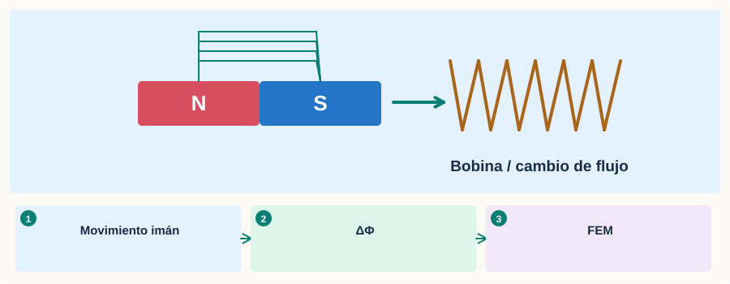

[← Anterior](04.md) · [Índice](../README.md) · [Siguiente →](06.md)

# 05 · Ley de Faraday y Lenz

*Diagrama didáctico y secuencia conceptual; no a escala.*

## ¿Qué es y por qué ocurre?

La FEM inducida media en N espiras es ε=−N ΔΦ/Δt si cada espira tiene el mismo flujo. El signo de Lenz indica que el efecto de la corriente inducida se opone al cambio de flujo que la produce. No hay FEM por flujo constante en este modelo; importa el cambio.

## Ejemplo explicado

> 50 espiras, ΔΦ=0,002 Wb en 0,1 s: |ε|=1 V.

## Ahora tú

100 espiras, cambio 0,001 Wb en 0,2 s. ¿Magnitud FEM?

[← Anterior](04.md) · [Índice](../README.md) · [Siguiente →](06.md)
