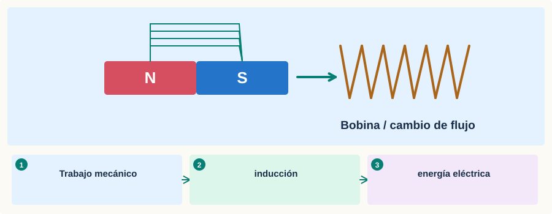

[← Anterior](05.md) · [Índice](../README.md) · [Actividades y cierre →](../descargas.md)

# 06 · Aplicaciones: motor, generador, transformador

*Diagrama didáctico y secuencia conceptual; no a escala.*

## ¿Qué es y por qué ocurre?

Un motor convierte energía eléctrica en trabajo mecánico mediante interacciones electromagnéticas; un generador transforma trabajo mecánico en energía eléctrica. Un transformador usa flujo variable para acoplar bobinas; no se estudia físicamente con red en este curso. Los campos y sus energías se conservan en el balance total.

## Ejemplo explicado

> Mover un imán más rápido en una bobina puede aumentar FEM si el cambio de flujo por recorrido es el mismo.

## Ahora tú

¿Por qué un imán inmóvil respecto a una bobina no induce tensión sostenida por sí solo?

[← Anterior](05.md) · [Índice](../README.md) · [Actividades y cierre →](../descargas.md)
