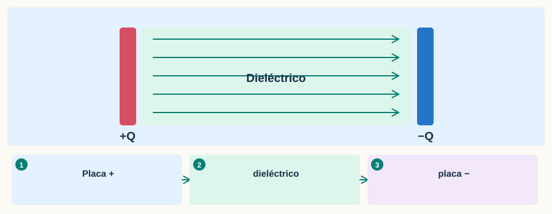
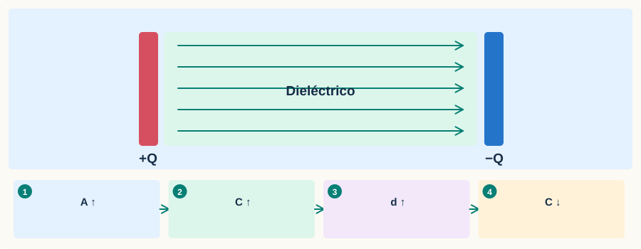
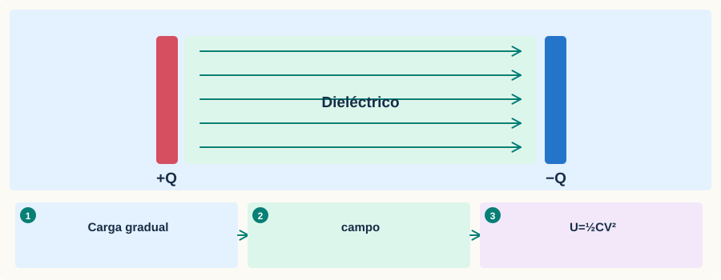
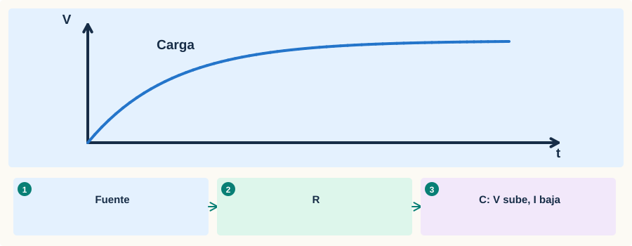
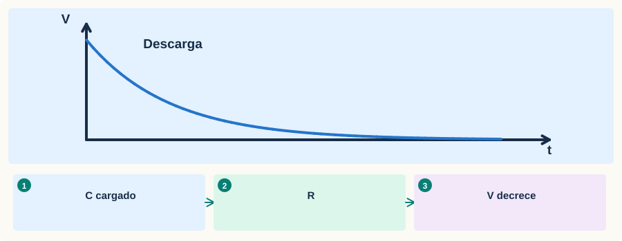
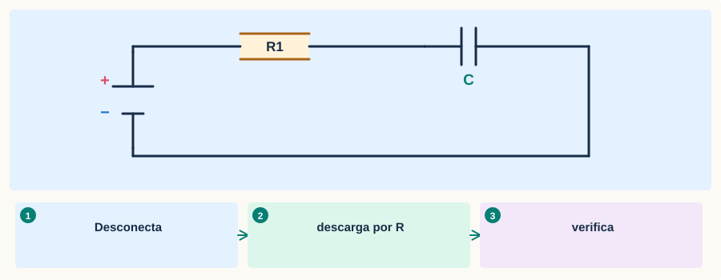

# Cuaderno de ejercicios · Clase 021

[PDF](021-ejercicios.pdf) · [← Índice](../README.md)

## 1. Qué es un condensador

**Ejemplo de estudio:** Un capacitor de 100 µF a 5 V tiene |Q|=500 µC en cada placa.

**Resuelve:** 47 µF a 3 V. Calcula |Q|.

Escribe datos, procedimiento, unidades (si corresponde), dibujo y justificación. No consultes la solución antes.

## 2. Geometría y dieléctrico

**Ejemplo de estudio:** Duplicar A con d y ε fijos duplica C.

**Resuelve:** Si duplicas d, ¿C ideal?

Escribe datos, procedimiento, unidades (si corresponde), dibujo y justificación. No consultes la solución antes.

## 3. Energía almacenada

**Ejemplo de estudio:** 100 µF a 5 V: U=0,00125 J=1,25 mJ.

**Resuelve:** 200 µF a 3 V. Calcula U.

Escribe datos, procedimiento, unidades (si corresponde), dibujo y justificación. No consultes la solución antes.

## 4. Carga RC y constante de tiempo

**Ejemplo de estudio:** R=10 kΩ, C=100 µF: τ=1 s; con 3 V, VC(1 s)≈1,90 V.

**Resuelve:** R=1 kΩ, C=100 µF. Calcula τ.

Escribe datos, procedimiento, unidades (si corresponde), dibujo y justificación. No consultes la solución antes.

## 5. Descarga y comportamiento DC

**Ejemplo de estudio:** V0=3 V y τ=1 s: tras 1 s, VC≈1,10 V.

**Resuelve:** Tras 5τ, ¿está exactamente a 0 V?

Escribe datos, procedimiento, unidades (si corresponde), dibujo y justificación. No consultes la solución antes.

## 6. Componentes reales y seguridad

**Ejemplo de estudio:** Un capacitor de 100 µF nominal 16 V con fuente 3 V correctamente orientado tiene margen de tensión, sujeto a especificación.

**Resuelve:** ¿Se descarga un capacitor cortocircuitando terminales?

Escribe datos, procedimiento, unidades (si corresponde), dibujo y justificación. No consultes la solución antes.
