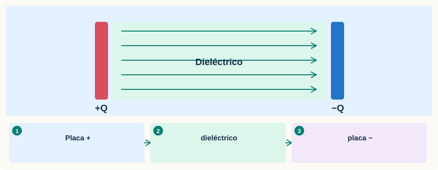
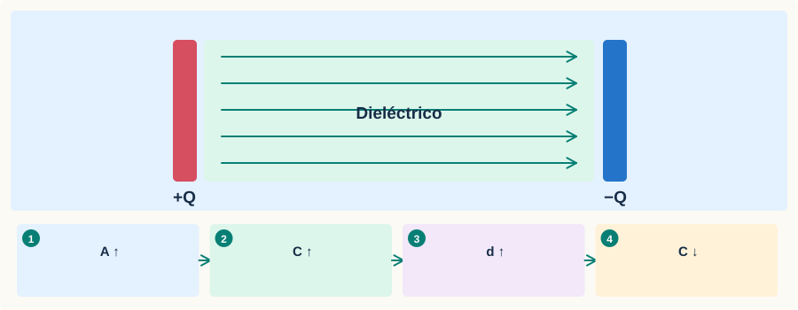
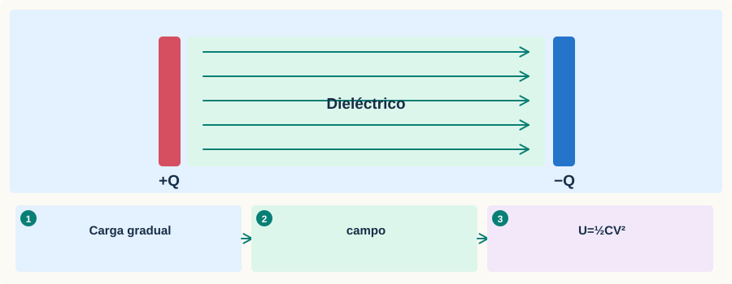
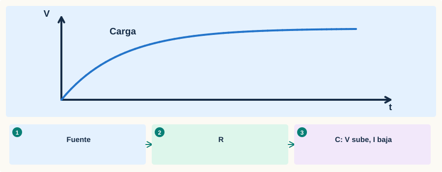
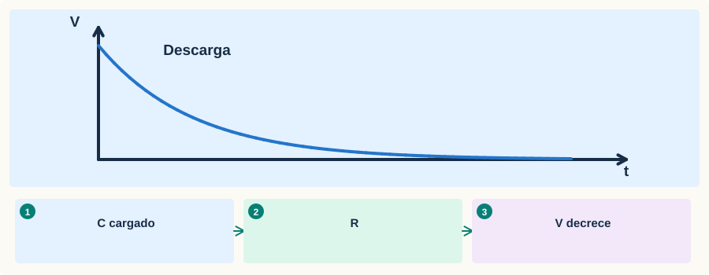
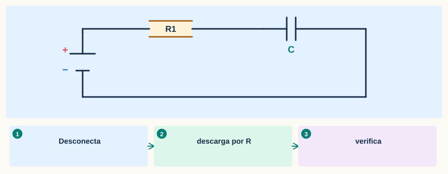

# Condensadores y almacenamiento de energía

[← Índice](../README.md)

## 01 · Qué es un condensador

Dos conductores separados por un aislante o dieléctrico pueden almacenar cargas de signos opuestos y energía en el campo eléctrico. La capacitancia C=Q/V para capacitor lineal mide carga de una placa por diferencia de potencial; unidad faradio (F=C/V). El conjunto ideal puede tener carga neta cero.

**Ejemplo:** Un capacitor de 100 µF a 5 V tiene |Q|=500 µC en cada placa.

**Aplica:** 47 µF a 3 V. Calcula |Q|.

---

## 02 · Geometría y dieléctrico

Para placas grandes, paralelas, separadas una distancia pequeña frente a sus dimensiones, C≈εA/d. Mayor área o permitividad aumenta C; mayor separación reduce C. El dieléctrico limita la conducción ordinaria, pero tiene tensión máxima y pérdidas reales.

**Ejemplo:** Duplicar A con d y ε fijos duplica C.

**Aplica:** Si duplicas d, ¿C ideal?

---

## 03 · Energía almacenada

El trabajo para cargar un capacitor lineal desde cero es U=½CV². El factor ½ aparece porque V aumenta de cero hasta su valor final al agregar carga. La energía puede entregarse posteriormente a un circuito. No confundir carga Q=CV con energía U.

**Ejemplo:** 100 µF a 5 V: U=0,00125 J=1,25 mJ.

**Aplica:** 200 µF a 3 V. Calcula U.

---

## 04 · Carga RC y constante de tiempo

Para fuente DC ideal V, resistor R y capacitor inicialmente descargado en serie, VC(t)=V(1−e^(−t/RC)). τ=RC mide escala temporal: a 1τ, VC≈63,2% de V. La corriente comienza en V/R y disminuye; idealmente tiende a cero, no a un corto permanente.

**Ejemplo:** R=10 kΩ, C=100 µF: τ=1 s; con 3 V, VC(1 s)≈1,90 V.

**Aplica:** R=1 kΩ, C=100 µF. Calcula τ.

---

## 05 · Descarga y comportamiento DC

Con capacitor inicialmente a V0 descargando mediante resistor, VC=V0e^(−t/RC). A τ queda≈36,8%; a 5τ queda≈0,67%. El capacitor ideal bloquea corriente DC sostenida una vez cargado, pero permite cambios transitorios; en AC su comportamiento depende de frecuencia.

**Ejemplo:** V0=3 V y τ=1 s: tras 1 s, VC≈1,10 V.

**Aplica:** Tras 5τ, ¿está exactamente a 0 V?

---

## 06 · Componentes reales y seguridad

Respeta tensión nominal, polaridad de electrolíticos, tolerancia y temperatura. Un capacitor puede mantener carga después de desconectar la fuente. Para práctica usa solo baja tensión, capacidad moderada, resistor y procedimiento de descarga supervisado; verifica tensión antes de tocar o medir Ω. No uses capacitores de equipos de red.

**Ejemplo:** Un capacitor de 100 µF nominal 16 V con fuente 3 V correctamente orientado tiene margen de tensión, sujeto a especificación.

**Aplica:** ¿Se descarga un capacitor cortocircuitando terminales?

---
