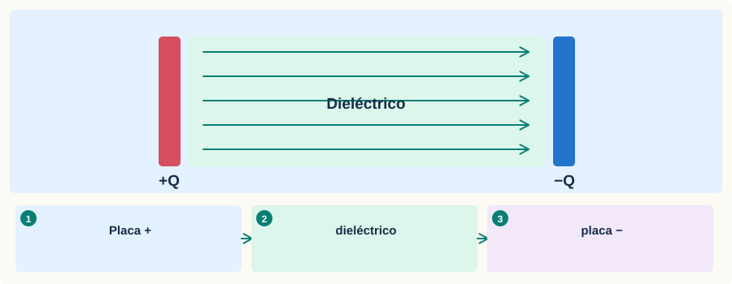

[← Portada](../README.md) · [Índice](../README.md) · [Siguiente →](02.md)

# 01 · Qué es un condensador

*Diagrama didáctico y secuencia conceptual; no a escala.*

## ¿Qué es y por qué ocurre?

Dos conductores separados por un aislante o dieléctrico pueden almacenar cargas de signos opuestos y energía en el campo eléctrico. La capacitancia C=Q/V para capacitor lineal mide carga de una placa por diferencia de potencial; unidad faradio (F=C/V). El conjunto ideal puede tener carga neta cero.

## Ejemplo explicado

> Un capacitor de 100 µF a 5 V tiene |Q|=500 µC en cada placa.

## Ahora tú

47 µF a 3 V. Calcula |Q|.

[← Portada](../README.md) · [Índice](../README.md) · [Siguiente →](02.md)
