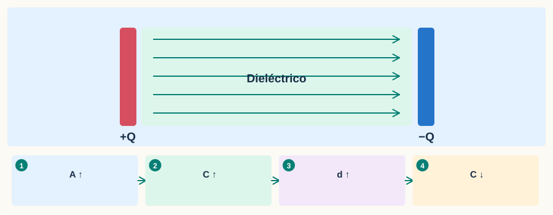
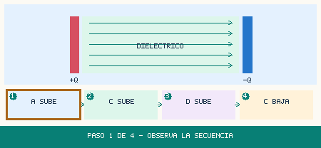

[← Anterior](01.md) · [Índice](../README.md) · [Siguiente →](03.md)

# 02 · Geometría y dieléctrico

*Diagrama didáctico y secuencia conceptual; no a escala.*

## ¿Qué es y por qué ocurre?

Para placas grandes, paralelas, separadas una distancia pequeña frente a sus dimensiones, C≈εA/d. Mayor área o permitividad aumenta C; mayor separación reduce C. El dieléctrico limita la conducción ordinaria, pero tiene tensión máxima y pérdidas reales.

## Ejemplo explicado

> Duplicar A con d y ε fijos duplica C.

## Ahora tú

Si duplicas d, ¿C ideal?

## Secuencia animada

*Se resaltan etapas del diagrama, no se pretende simular el movimiento físico real.*

[← Anterior](01.md) · [Índice](../README.md) · [Siguiente →](03.md)
