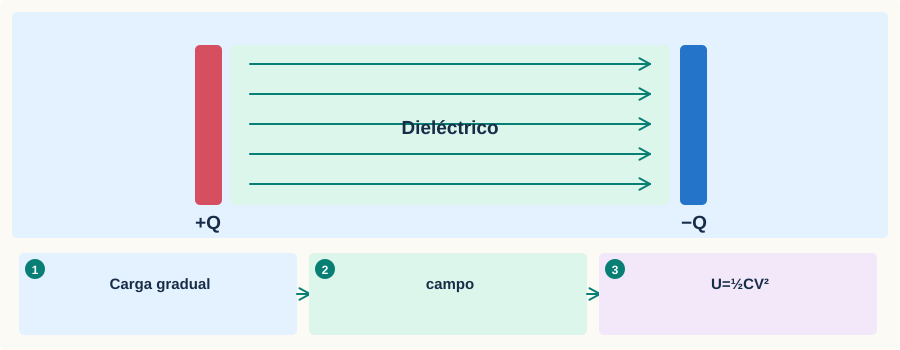

[← Anterior](02.md) · [Índice](../README.md) · [Siguiente →](04.md)

# 03 · Energía almacenada

*Diagrama didáctico y secuencia conceptual; no a escala.*

## ¿Qué es y por qué ocurre?

El trabajo para cargar un capacitor lineal desde cero es U=½CV². El factor ½ aparece porque V aumenta de cero hasta su valor final al agregar carga. La energía puede entregarse posteriormente a un circuito. No confundir carga Q=CV con energía U.

## Ejemplo explicado

> 100 µF a 5 V: U=0,00125 J=1,25 mJ.

## Ahora tú

200 µF a 3 V. Calcula U.

[← Anterior](02.md) · [Índice](../README.md) · [Siguiente →](04.md)
