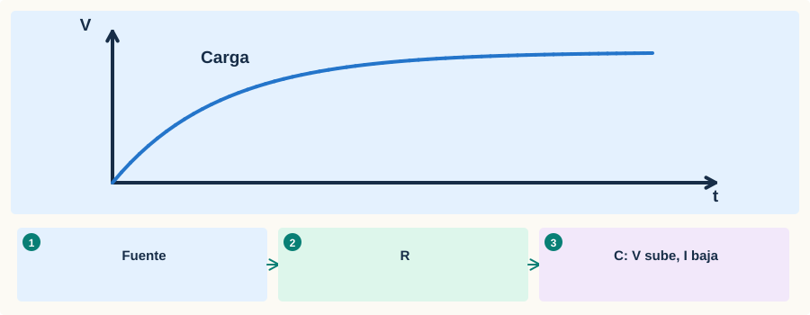

[← Anterior](03.md) · [Índice](../README.md) · [Siguiente →](05.md)

# 04 · Carga RC y constante de tiempo

*Diagrama didáctico y secuencia conceptual; no a escala.*

## ¿Qué es y por qué ocurre?

Para fuente DC ideal V, resistor R y capacitor inicialmente descargado en serie, VC(t)=V(1−e^(−t/RC)). τ=RC mide escala temporal: a 1τ, VC≈63,2% de V. La corriente comienza en V/R y disminuye; idealmente tiende a cero, no a un corto permanente.

## Ejemplo explicado

> R=10 kΩ, C=100 µF: τ=1 s; con 3 V, VC(1 s)≈1,90 V.

## Ahora tú

R=1 kΩ, C=100 µF. Calcula τ.

[← Anterior](03.md) · [Índice](../README.md) · [Siguiente →](05.md)
