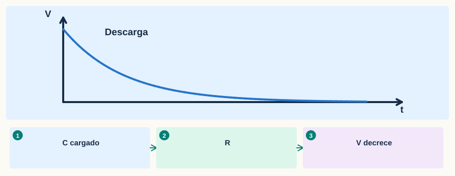

[← Anterior](04.md) · [Índice](../README.md) · [Siguiente →](06.md)

# 05 · Descarga y comportamiento DC

*Diagrama didáctico y secuencia conceptual; no a escala.*

## ¿Qué es y por qué ocurre?

Con capacitor inicialmente a V0 descargando mediante resistor, VC=V0e^(−t/RC). A τ queda≈36,8%; a 5τ queda≈0,67%. El capacitor ideal bloquea corriente DC sostenida una vez cargado, pero permite cambios transitorios; en AC su comportamiento depende de frecuencia.

## Ejemplo explicado

> V0=3 V y τ=1 s: tras 1 s, VC≈1,10 V.

## Ahora tú

Tras 5τ, ¿está exactamente a 0 V?

[← Anterior](04.md) · [Índice](../README.md) · [Siguiente →](06.md)
