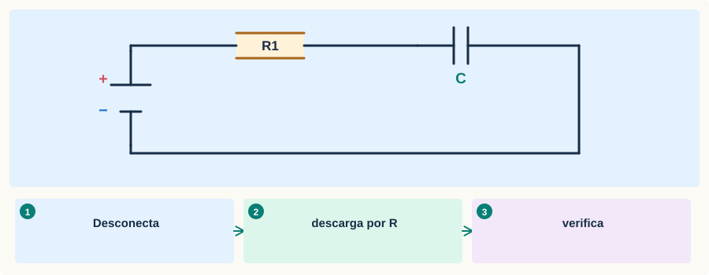

[← Anterior](05.md) · [Índice](../README.md) · [Actividades y cierre →](../descargas.md)

# 06 · Componentes reales y seguridad

*Diagrama didáctico y secuencia conceptual; no a escala.*

## ¿Qué es y por qué ocurre?

Respeta tensión nominal, polaridad de electrolíticos, tolerancia y temperatura. Un capacitor puede mantener carga después de desconectar la fuente. Para práctica usa solo baja tensión, capacidad moderada, resistor y procedimiento de descarga supervisado; verifica tensión antes de tocar o medir Ω. No uses capacitores de equipos de red.

## Ejemplo explicado

> Un capacitor de 100 µF nominal 16 V con fuente 3 V correctamente orientado tiene margen de tensión, sujeto a especificación.

## Ahora tú

¿Se descarga un capacitor cortocircuitando terminales?

[← Anterior](05.md) · [Índice](../README.md) · [Actividades y cierre →](../descargas.md)
