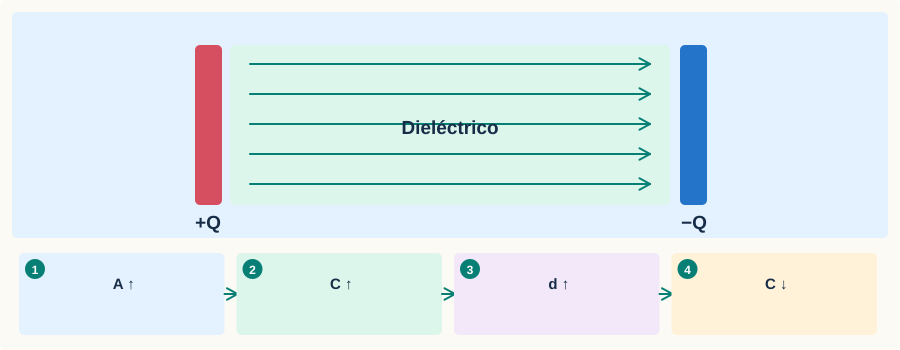

# Práctica guiada · Condensadores y almacenamiento de energía

**Objetivo:** ¿Dónde queda la energía y por qué no hay corriente DC sostenida ideal?

## Procedimiento

Primero simula RC con 3 V, 10 kΩ, 100 µF. Registra VC a 0, 1, 2, 3 y 5 s; compara 63,2% y 36,8%. Opcional supervisado: capacitor 16 V correctamente polarizado, fuente limitada, resistor, descarga controlada y verificación. No usar capacitores de alta energía.

1. Formula hipótesis y dibuja el modelo antes de intervenir.
2. Identifica magnitudes que cambian y las que permanecen fijas.
3. Realiza solo el procedimiento seguro descrito; registra resultados y unidades.
4. Compara con predicción; explica diferencias, incertidumbre y limitaciones.

| Ensayo | Condiciones | Predicción | Observación o cálculo | Explicación |
|---|---|---|---|---|
| 1 | | | | |
| 2 | | | | |
| 3 | | | | |

Rúbrica: predicción 25, registro 25, explicación 40, presentación 10. Seguridad obligatoria. En simulación, los resultados calculados no son evidencia experimental independiente.

[Simulador complementario PhET](https://phet.colorado.edu/es/simulations/capacitor-lab-basics) · [Plantilla de informe](../../../../../plantillas/informe-laboratorio.pdf) · [PDF](021-laboratorio.pdf) · [← Índice](../README.md)
