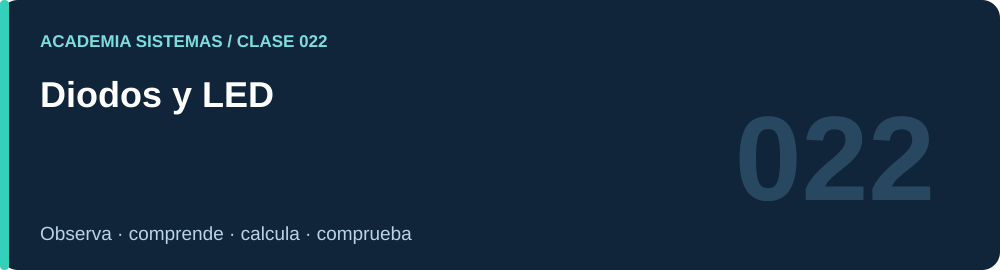
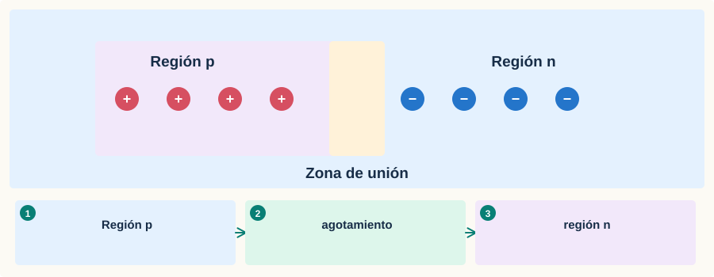

[← Clase 021](../021-condensadores/README.md) · [Índice](../README.md) · [Clase 023 →](../023-diagnostico-fallas/README.md)

# Clase 022 · Diodos y LED

**6 temas desarrollados · 120–180 min orientativos, ampliables por dominio.**

> ¿Por qué un LED emite luz y necesita limitar corriente?

[▶ Comenzar a leer](libro/01.md) · [Libro web](https://mangelmorenomoreno.github.io/academia-sistemas/modulos/01-electronica-basica/clases/022-diodos-led/libro.html) · [Descargas](descargas.md)

| Página | Tema |
|---|---|
| 01 | [Semiconductor y unión PN](libro/01.md) |
| 02 | [Polarización directa e inversa](libro/02.md) |
| 03 | [LED y recombinación](libro/03.md) |
| 04 | [Por qué limitar corriente](libro/04.md) |
| 05 | [Potencia y polaridad](libro/05.md) |
| 06 | [Montaje y diagnóstico](libro/06.md) |

## Material de estudio

[Lectura completa](lecturas/guia-ampliada.md) · [Presentación web](https://mangelmorenomoreno.github.io/academia-sistemas/modulos/01-electronica-basica/clases/022-diodos-led/presentacion.html) · [Ejercicios](ejercicios/README.md) · [Práctica](practicas/README.md) · [Evaluación](pruebas/README.md) · [Soluciones](soluciones/README.md) · [Guía docente](guia-docente.md) · [Recursos](recursos/videos-y-simulaciones.md)

> [!CAUTION]
> Prácticas físicas solo con baja tensión, fuente limitada o apropiada y supervisión; desenergiza antes de modificar conexiones. Nunca trabajar con la red doméstica, provocar cortos ni utilizar componentes dañados.

[← Clase 021](../021-condensadores/README.md) · [Índice](../README.md) · [Clase 023 →](../023-diagnostico-fallas/README.md)
