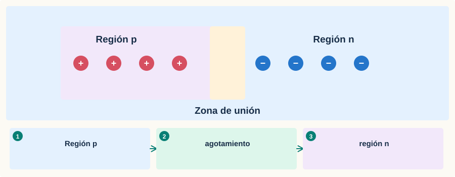
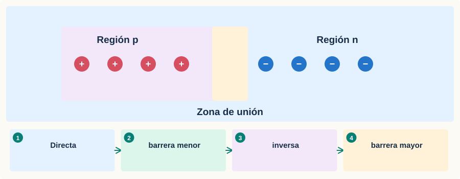
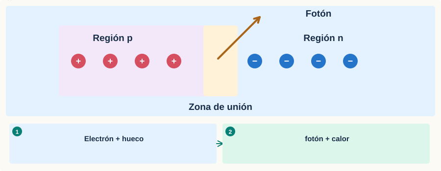
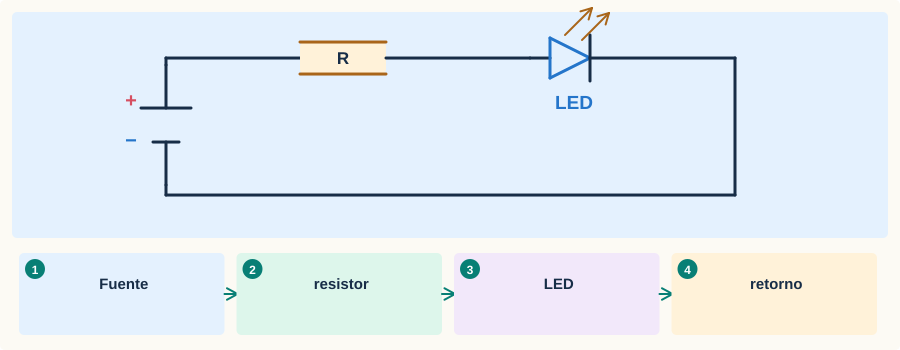
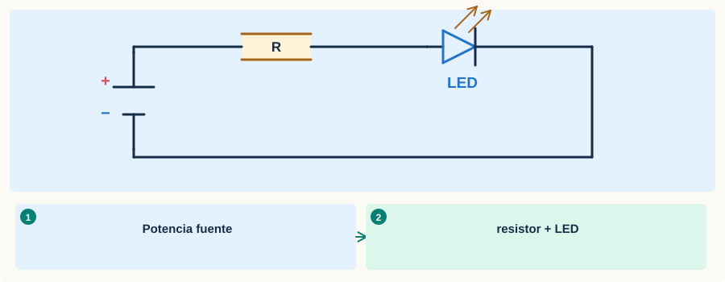
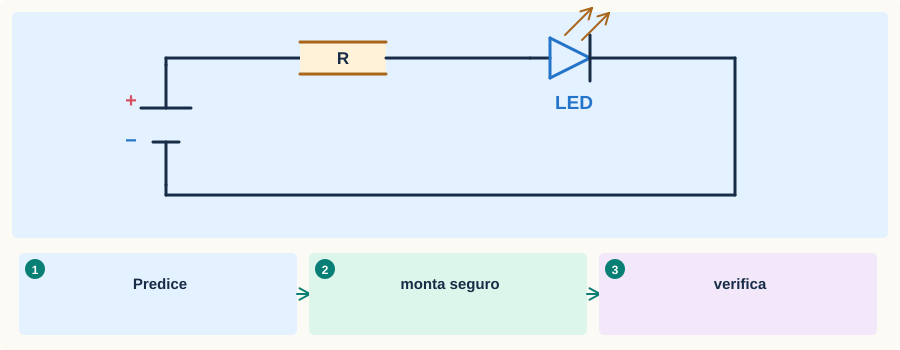

# Cuaderno de ejercicios · Clase 022

[PDF](022-ejercicios.pdf) · [← Índice](../README.md)

## 1. Semiconductor y unión PN

**Ejemplo de estudio:** Un diodo PN tiene ánodo y cátodo; no es simplemente un resistor polarizado.

**Resuelve:** ¿Un hueco es un protón moviéndose por el silicio?

Escribe datos, procedimiento, unidades (si corresponde), dibujo y justificación. No consultes la solución antes.

## 2. Polarización directa e inversa

**Ejemplo de estudio:** Un diodo de silicio puede tener caída aproximada 0,6–0,8 V en ciertas condiciones, no valor fijo universal.

**Resuelve:** ¿Un diodo en inversa es siempre un aislante perfecto?

Escribe datos, procedimiento, unidades (si corresponde), dibujo y justificación. No consultes la solución antes.

## 3. LED y recombinación

**Ejemplo de estudio:** Un LED rojo y uno azul pueden tener caídas directas diferentes al mismo nivel de corriente.

**Resuelve:** ¿La energía de la luz aparece de la nada?

Escribe datos, procedimiento, unidades (si corresponde), dibujo y justificación. No consultes la solución antes.

## 4. Por qué limitar corriente

**Ejemplo de estudio:** 5 V, LED rojo Vf≈2 V, I=10 mA: R≈300 Ω. Elegir 330 Ω da ≈9,1 mA.

**Resuelve:** 3 V, Vf≈1,8 V, objetivo 5 mA. ¿R?

Escribe datos, procedimiento, unidades (si corresponde), dibujo y justificación. No consultes la solución antes.

## 5. Potencia y polaridad

**Ejemplo de estudio:** Invertir LED puede impedir luz y exceder tensión inversa permitida si se aplica fuente inadecuada.

**Resuelve:** ¿La potencia eléctrica del LED se convierte toda en luz?

Escribe datos, procedimiento, unidades (si corresponde), dibujo y justificación. No consultes la solución antes.

## 6. Montaje y diagnóstico

**Ejemplo de estudio:** Con 3 V y LED rojo Vf≈2 V, 330 Ω da ≈3 mA; brillo depende del LED.

**Resuelve:** ¿Qué revisar primero si el LED no enciende?

Escribe datos, procedimiento, unidades (si corresponde), dibujo y justificación. No consultes la solución antes.
