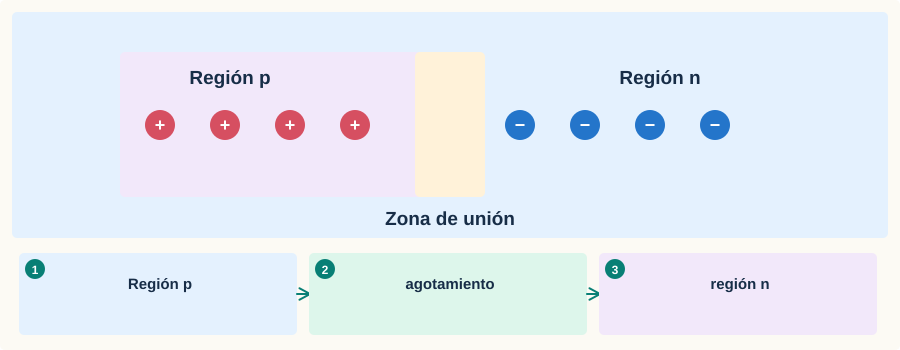
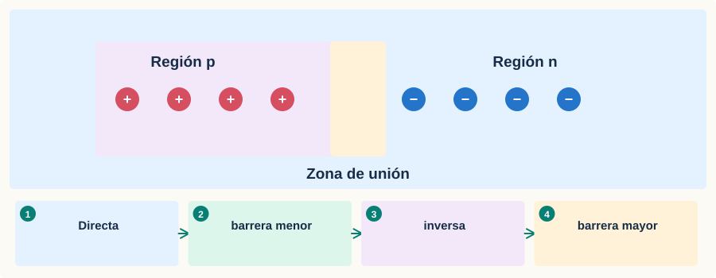
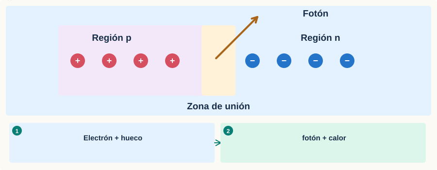
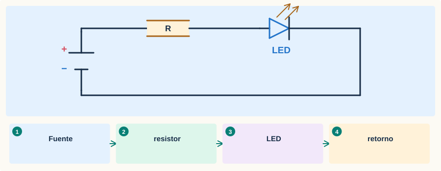
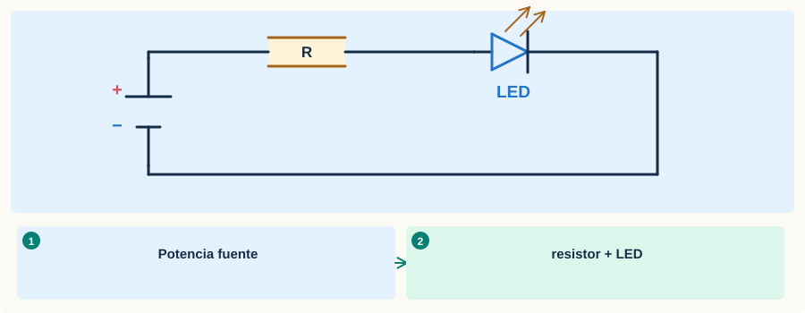
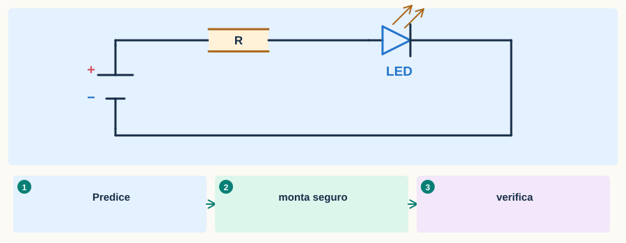

# Diodos y LED

[← Índice](../README.md)

## 01 · Semiconductor y unión PN

Un semiconductor como silicio permite controlar portadores. Dopaje tipo n aumenta electrones disponibles; tipo p crea huecos (estados que se comportan como portadores positivos). Al unir regiones aparece una zona de agotamiento y un campo interno. Los materiales siguen aproximadamente neutros fuera de esa región.

**Ejemplo:** Un diodo PN tiene ánodo y cátodo; no es simplemente un resistor polarizado.

**Aplica:** ¿Un hueco es un protón moviéndose por el silicio?

---

## 02 · Polarización directa e inversa

En directa, ánodo a potencial mayor que cátodo, se reduce la barrera y la corriente aumenta de forma no lineal. En inversa, la corriente suele ser pequeña hasta ruptura, que puede dañar un diodo no diseñado para ello. No hay un umbral universal exacto; depende de dispositivo, corriente y temperatura.

**Ejemplo:** Un diodo de silicio puede tener caída aproximada 0,6–0,8 V en ciertas condiciones, no valor fijo universal.

**Aplica:** ¿Un diodo en inversa es siempre un aislante perfecto?

---

## 03 · LED y recombinación

Un LED emite fotones cuando electrones y huecos se recombinan en un semiconductor adecuado. La energía de fotón está relacionada con la brecha energética y la frecuencia: E=hf. Parte de la energía se transforma en calor. El color depende del material y diseño, no solo del voltaje aplicado.

**Ejemplo:** Un LED rojo y uno azul pueden tener caídas directas diferentes al mismo nivel de corriente.

**Aplica:** ¿La energía de la luz aparece de la nada?

---

## 04 · Por qué limitar corriente

La relación I-V del LED es muy no lineal; un pequeño aumento de tensión puede elevar mucho la corriente. Un resistor en serie reduce sensibilidad y limita corriente. Para aproximación DC, R=(Vs−Vf)/Iobjetivo, con Vs>Vf y Vf tomado de datos a corriente prevista. Comprueba potencia y tolerancias.

**Ejemplo:** 5 V, LED rojo Vf≈2 V, I=10 mA: R≈300 Ω. Elegir 330 Ω da ≈9,1 mA.

**Aplica:** 3 V, Vf≈1,8 V, objetivo 5 mA. ¿R?

---

## 05 · Potencia y polaridad

P_R≈I²R y P_LED≈VfI. En ejemplo 5 V, 330 Ω y Vf≈2 V: I≈9,09 mA, P_R≈27,3 mW, P_LED≈18,2 mW; total≈45,5 mW. La barra del símbolo es cátodo; el encapsulado puede tener pata corta o marca, pero verifica hoja de datos.

**Ejemplo:** Invertir LED puede impedir luz y exceder tensión inversa permitida si se aplica fuente inadecuada.

**Aplica:** ¿La potencia eléctrica del LED se convierte toda en luz?

---

## 06 · Montaje y diagnóstico

Usa fuente limitada de 3–5 V, resistor calculado, LED con datos conocidos y supervisión. Conecta sin energía, comprueba polaridad, revisa que no haya puentes y mide V en paralelo. No uses baterías de alta corriente sin limitación. Si no enciende, desconecta y revisa circuito, polaridad y valores.

**Ejemplo:** Con 3 V y LED rojo Vf≈2 V, 330 Ω da ≈3 mA; brillo depende del LED.

**Aplica:** ¿Qué revisar primero si el LED no enciende?

---
