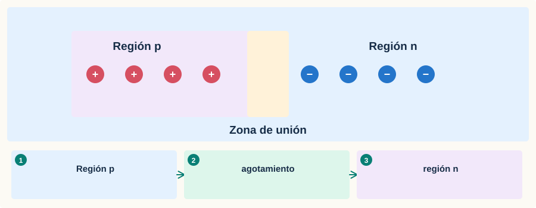

[← Portada](../README.md) · [Índice](../README.md) · [Siguiente →](02.md)

# 01 · Semiconductor y unión PN

*Diagrama didáctico y secuencia conceptual; no a escala.*

## ¿Qué es y por qué ocurre?

Un semiconductor como silicio permite controlar portadores. Dopaje tipo n aumenta electrones disponibles; tipo p crea huecos (estados que se comportan como portadores positivos). Al unir regiones aparece una zona de agotamiento y un campo interno. Los materiales siguen aproximadamente neutros fuera de esa región.

## Ejemplo explicado

> Un diodo PN tiene ánodo y cátodo; no es simplemente un resistor polarizado.

## Ahora tú

¿Un hueco es un protón moviéndose por el silicio?

[← Portada](../README.md) · [Índice](../README.md) · [Siguiente →](02.md)
