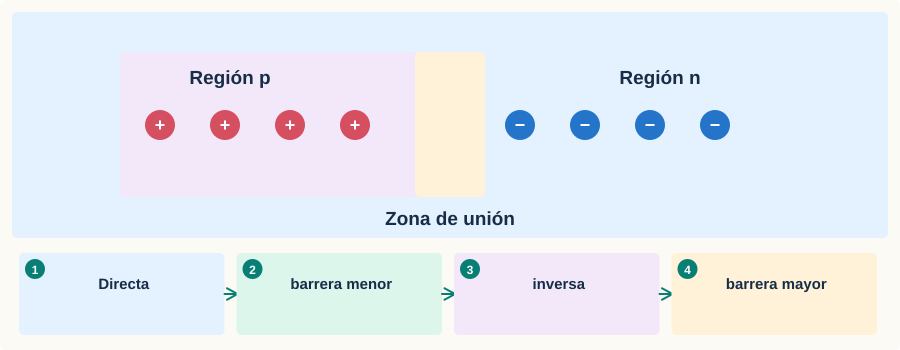
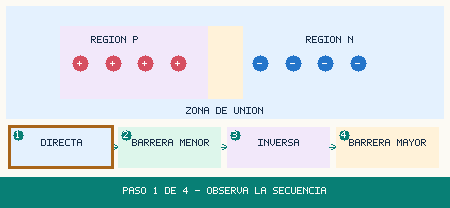

[← Anterior](01.md) · [Índice](../README.md) · [Siguiente →](03.md)

# 02 · Polarización directa e inversa

*Diagrama didáctico y secuencia conceptual; no a escala.*

## ¿Qué es y por qué ocurre?

En directa, ánodo a potencial mayor que cátodo, se reduce la barrera y la corriente aumenta de forma no lineal. En inversa, la corriente suele ser pequeña hasta ruptura, que puede dañar un diodo no diseñado para ello. No hay un umbral universal exacto; depende de dispositivo, corriente y temperatura.

## Ejemplo explicado

> Un diodo de silicio puede tener caída aproximada 0,6–0,8 V en ciertas condiciones, no valor fijo universal.

## Ahora tú

¿Un diodo en inversa es siempre un aislante perfecto?

## Secuencia animada

*Se resaltan etapas del diagrama, no se pretende simular el movimiento físico real.*

[← Anterior](01.md) · [Índice](../README.md) · [Siguiente →](03.md)
