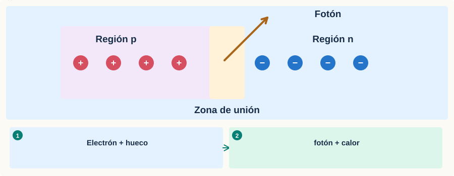

[← Anterior](02.md) · [Índice](../README.md) · [Siguiente →](04.md)

# 03 · LED y recombinación

*Diagrama didáctico y secuencia conceptual; no a escala.*

## ¿Qué es y por qué ocurre?

Un LED emite fotones cuando electrones y huecos se recombinan en un semiconductor adecuado. La energía de fotón está relacionada con la brecha energética y la frecuencia: E=hf. Parte de la energía se transforma en calor. El color depende del material y diseño, no solo del voltaje aplicado.

## Ejemplo explicado

> Un LED rojo y uno azul pueden tener caídas directas diferentes al mismo nivel de corriente.

## Ahora tú

¿La energía de la luz aparece de la nada?

[← Anterior](02.md) · [Índice](../README.md) · [Siguiente →](04.md)
