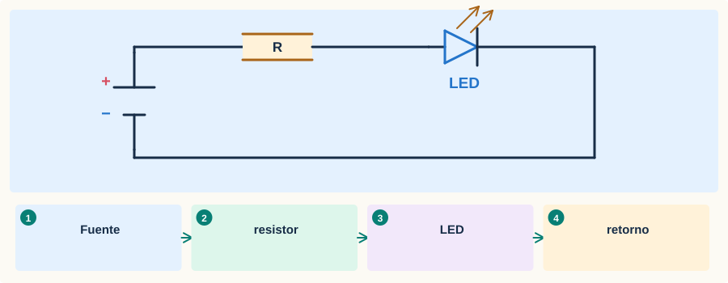

[← Anterior](03.md) · [Índice](../README.md) · [Siguiente →](05.md)

# 04 · Por qué limitar corriente

*Diagrama didáctico y secuencia conceptual; no a escala.*

## ¿Qué es y por qué ocurre?

La relación I-V del LED es muy no lineal; un pequeño aumento de tensión puede elevar mucho la corriente. Un resistor en serie reduce sensibilidad y limita corriente. Para aproximación DC, R=(Vs−Vf)/Iobjetivo, con Vs>Vf y Vf tomado de datos a corriente prevista. Comprueba potencia y tolerancias.

## Ejemplo explicado

> 5 V, LED rojo Vf≈2 V, I=10 mA: R≈300 Ω. Elegir 330 Ω da ≈9,1 mA.

## Ahora tú

3 V, Vf≈1,8 V, objetivo 5 mA. ¿R?

[← Anterior](03.md) · [Índice](../README.md) · [Siguiente →](05.md)
