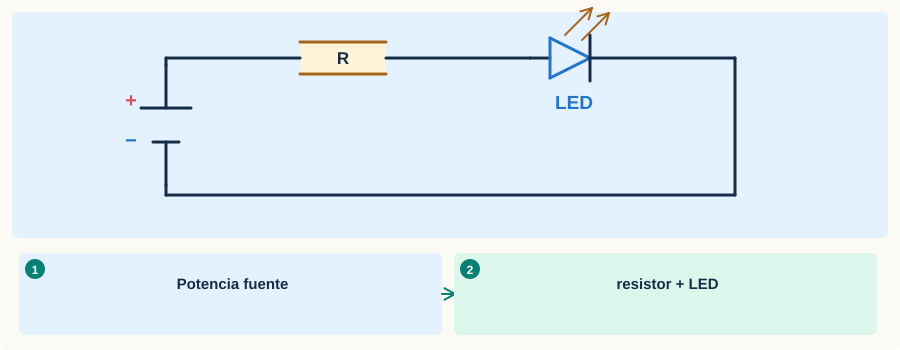

[← Anterior](04.md) · [Índice](../README.md) · [Siguiente →](06.md)

# 05 · Potencia y polaridad

*Diagrama didáctico y secuencia conceptual; no a escala.*

## ¿Qué es y por qué ocurre?

P_R≈I²R y P_LED≈VfI. En ejemplo 5 V, 330 Ω y Vf≈2 V: I≈9,09 mA, P_R≈27,3 mW, P_LED≈18,2 mW; total≈45,5 mW. La barra del símbolo es cátodo; el encapsulado puede tener pata corta o marca, pero verifica hoja de datos.

## Ejemplo explicado

> Invertir LED puede impedir luz y exceder tensión inversa permitida si se aplica fuente inadecuada.

## Ahora tú

¿La potencia eléctrica del LED se convierte toda en luz?

[← Anterior](04.md) · [Índice](../README.md) · [Siguiente →](06.md)
