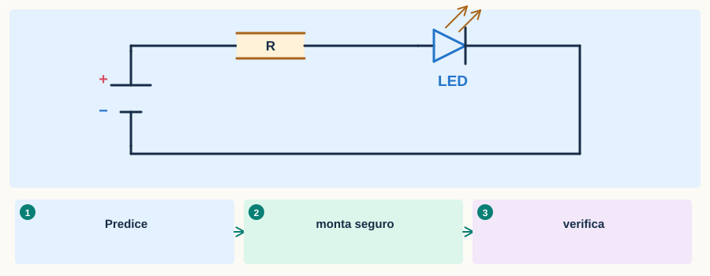

[← Anterior](05.md) · [Índice](../README.md) · [Actividades y cierre →](../descargas.md)

# 06 · Montaje y diagnóstico

*Diagrama didáctico y secuencia conceptual; no a escala.*

## ¿Qué es y por qué ocurre?

Usa fuente limitada de 3–5 V, resistor calculado, LED con datos conocidos y supervisión. Conecta sin energía, comprueba polaridad, revisa que no haya puentes y mide V en paralelo. No uses baterías de alta corriente sin limitación. Si no enciende, desconecta y revisa circuito, polaridad y valores.

## Ejemplo explicado

> Con 3 V y LED rojo Vf≈2 V, 330 Ω da ≈3 mA; brillo depende del LED.

## Ahora tú

¿Qué revisar primero si el LED no enciende?

[← Anterior](05.md) · [Índice](../README.md) · [Actividades y cierre →](../descargas.md)
