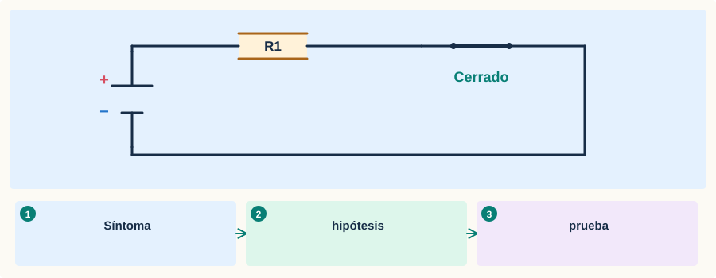
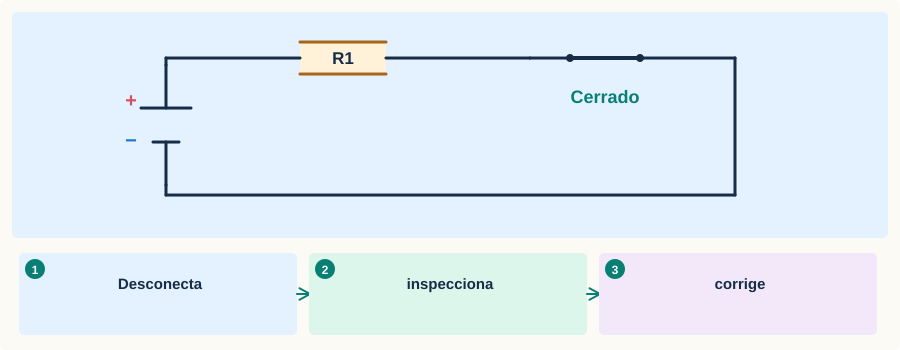
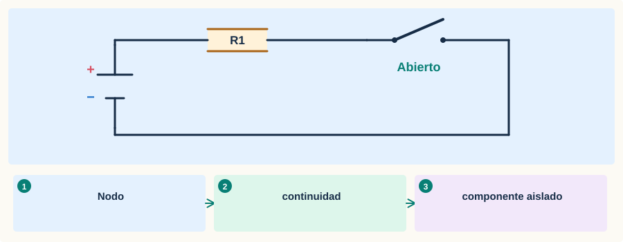
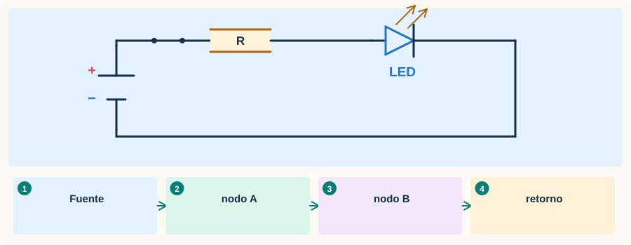
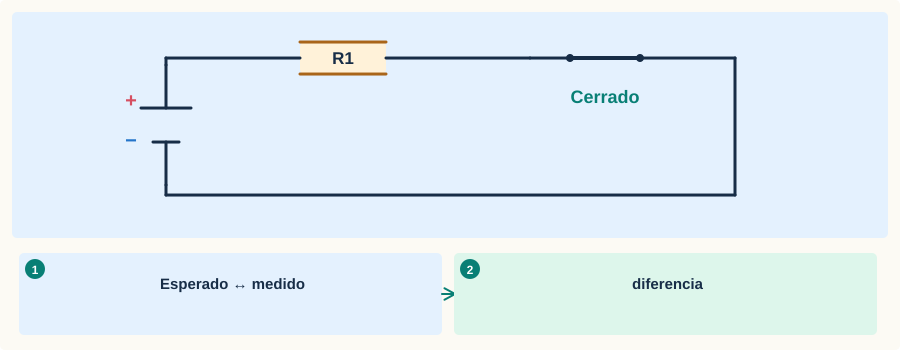
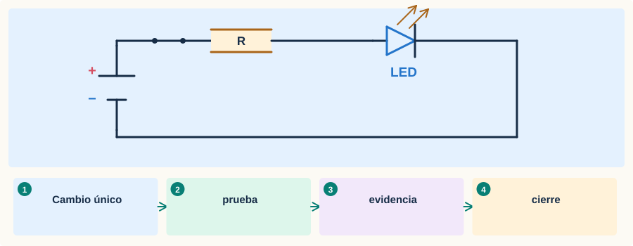

# Cuaderno de ejercicios · Clase 023

[PDF](023-ejercicios.pdf) · [← Índice](../README.md)

## 1. Método de ingeniería

**Ejemplo de estudio:** LED apagado: hipótesis fuente sin tensión, interruptor abierto, polaridad o conexión incorrecta.

**Resuelve:** ¿Una lámpara apagada demuestra que el LED está dañado?

Escribe datos, procedimiento, unidades (si corresponde), dibujo y justificación. No consultes la solución antes.

## 2. Inspección y seguridad

**Ejemplo de estudio:** Una pata del resistor en la misma fila que la otra puede puentear su función.

**Resuelve:** ¿Qué haces al encontrar un posible corto?

Escribe datos, procedimiento, unidades (si corresponde), dibujo y justificación. No consultes la solución antes.

## 3. Pruebas de continuidad y resistencia

**Ejemplo de estudio:** 330 Ω ±5% medidos 340 Ω aislado es compatible si incertidumbre razonable.

**Resuelve:** ¿Por qué medir resistencia dentro de una red puede engañar?

Escribe datos, procedimiento, unidades (si corresponde), dibujo y justificación. No consultes la solución antes.

## 4. Medición de tensión por etapas

**Ejemplo de estudio:** Fuente 3 V, interruptor abierto y carga conectada a retorno: tensión sobre contacto abierto≈3 V en modelo ideal.

**Resuelve:** Si Vfuente=0, ¿qué hipótesis revisas antes de sustituir LED?

Escribe datos, procedimiento, unidades (si corresponde), dibujo y justificación. No consultes la solución antes.

## 5. Predicción frente a medición

**Ejemplo de estudio:** Esperado 3,00 V y medido 2,94 V: desviación relativa 2%.

**Resuelve:** Esperado 10 mA, medido 9,5 mA. ¿Desviación?

Escribe datos, procedimiento, unidades (si corresponde), dibujo y justificación. No consultes la solución antes.

## 6. Documentar y confirmar

**Ejemplo de estudio:** Si invertir LED correctamente restaura funcionamiento, documenta polaridad inicial y verifica corriente limitada.

**Resuelve:** ¿Por qué no cambiar tres componentes simultáneamente?

Escribe datos, procedimiento, unidades (si corresponde), dibujo y justificación. No consultes la solución antes.
