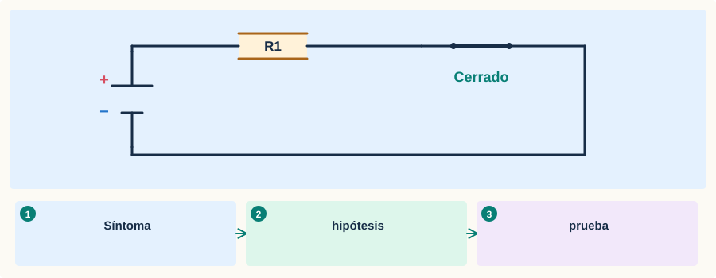
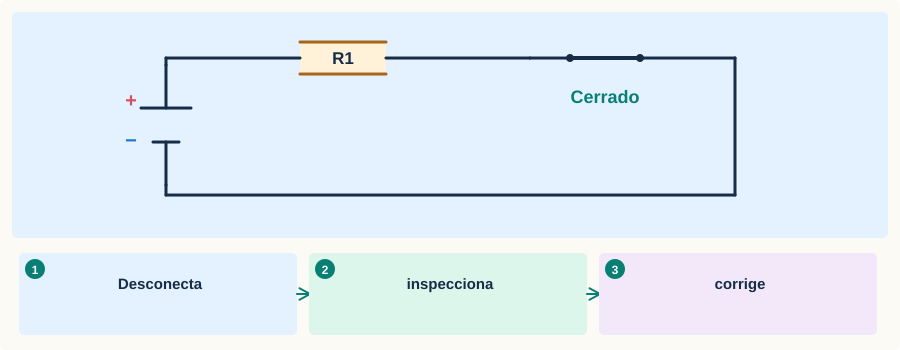
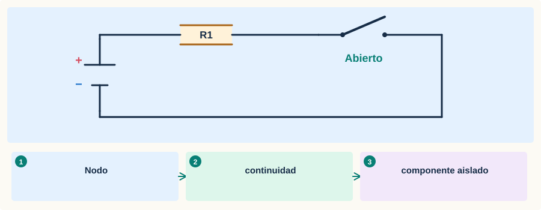
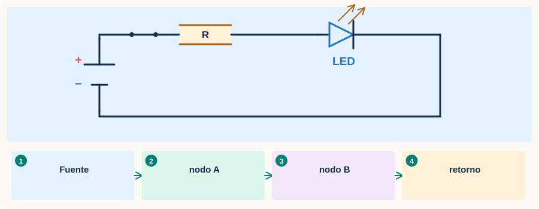
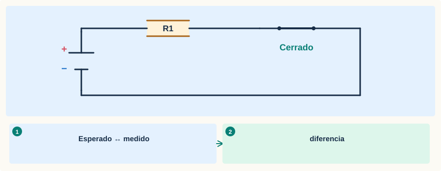
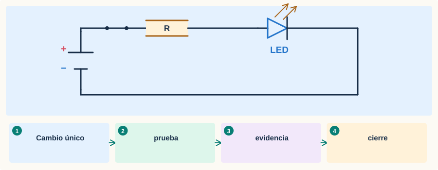

# Diagnóstico de fallas eléctricas

[← Índice](../README.md)

## 01 · Método de ingeniería

Define comportamiento esperado, síntomas, condiciones y límites. Formula hipótesis comprobables antes de intervenir. Distingue causa, síntoma y evidencia. Una falla intermitente puede requerir registrar condiciones y repetir observación, no adivinar.

**Ejemplo:** LED apagado: hipótesis fuente sin tensión, interruptor abierto, polaridad o conexión incorrecta.

**Aplica:** ¿Una lámpara apagada demuestra que el LED está dañado?

---

## 02 · Inspección y seguridad

Desenergiza antes de tocar cableado; verifica ausencia de tensión y descarga segura de capacitores si existen. Inspecciona puentes, componentes, filas de protoboard y polaridad. No huelas de cerca, toques componentes calientes ni energices un circuito sospechoso de corto.

**Ejemplo:** Una pata del resistor en la misma fila que la otra puede puentear su función.

**Aplica:** ¿Qué haces al encontrar un posible corto?

---

## 03 · Pruebas de continuidad y resistencia

Con alimentación desconectada, verifica cables y nodos esperados. Aísla componentes si hay caminos alternos. El multímetro en continuidad tiene umbral, por eso un pitido no prueba resistencia exactamente cero. Compara valor con tolerancia e incertidumbre.

**Ejemplo:** 330 Ω ±5% medidos 340 Ω aislado es compatible si incertidumbre razonable.

**Aplica:** ¿Por qué medir resistencia dentro de una red puede engañar?

---

## 04 · Medición de tensión por etapas

Tras verificar seguridad, energiza bajo supervisión. Mide fuente entre bornes y después cada nodo respecto a referencia. En circuito serie, una abertura puede dejar casi toda tensión sobre ella y cero sobre otros elementos, según caminos y medidor. No usar medidas de Ω con fuente conectada.

**Ejemplo:** Fuente 3 V, interruptor abierto y carga conectada a retorno: tensión sobre contacto abierto≈3 V en modelo ideal.

**Aplica:** Si Vfuente=0, ¿qué hipótesis revisas antes de sustituir LED?

---

## 05 · Predicción frente a medición

Calcula valor esperado con tolerancias. Para resistor, I inferida=VR/R evita abrir el circuito si se conoce R. El error relativo respecto a referencia no nula es |medido−esperado|/|esperado|×100%; no implica por sí solo falla si incertidumbre/modelo explican diferencia.

**Ejemplo:** Esperado 3,00 V y medido 2,94 V: desviación relativa 2%.

**Aplica:** Esperado 10 mA, medido 9,5 mA. ¿Desviación?

---

## 06 · Documentar y confirmar

Cambia una cosa por vez; registra resultado y repite prueba. Una reparación exitosa exige verificar comportamiento esperado y que no introdujo otra falla. El informe incluye esquema, fotos/dibujos, valores, hipótesis descartadas, causa confirmada y prevención. En software el mismo patrón se usa para depurar.

**Ejemplo:** Si invertir LED correctamente restaura funcionamiento, documenta polaridad inicial y verifica corriente limitada.

**Aplica:** ¿Por qué no cambiar tres componentes simultáneamente?

---
