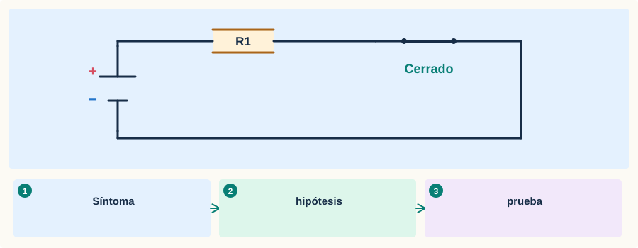

[← Portada](../README.md) · [Índice](../README.md) · [Siguiente →](02.md)

# 01 · Método de ingeniería

*Diagrama didáctico y secuencia conceptual; no a escala.*

## ¿Qué es y por qué ocurre?

Define comportamiento esperado, síntomas, condiciones y límites. Formula hipótesis comprobables antes de intervenir. Distingue causa, síntoma y evidencia. Una falla intermitente puede requerir registrar condiciones y repetir observación, no adivinar.

## Ejemplo explicado

> LED apagado: hipótesis fuente sin tensión, interruptor abierto, polaridad o conexión incorrecta.

## Ahora tú

¿Una lámpara apagada demuestra que el LED está dañado?

[← Portada](../README.md) · [Índice](../README.md) · [Siguiente →](02.md)
