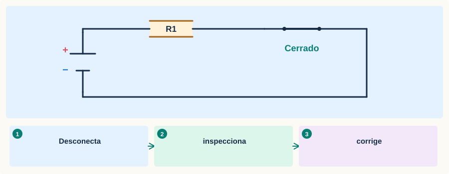
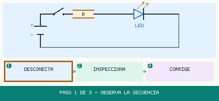

[← Anterior](01.md) · [Índice](../README.md) · [Siguiente →](03.md)

# 02 · Inspección y seguridad

*Diagrama didáctico y secuencia conceptual; no a escala.*

## ¿Qué es y por qué ocurre?

Desenergiza antes de tocar cableado; verifica ausencia de tensión y descarga segura de capacitores si existen. Inspecciona puentes, componentes, filas de protoboard y polaridad. No huelas de cerca, toques componentes calientes ni energices un circuito sospechoso de corto.

## Ejemplo explicado

> Una pata del resistor en la misma fila que la otra puede puentear su función.

## Ahora tú

¿Qué haces al encontrar un posible corto?

## Secuencia animada

*Se resaltan etapas del diagrama, no se pretende simular el movimiento físico real.*

[← Anterior](01.md) · [Índice](../README.md) · [Siguiente →](03.md)
