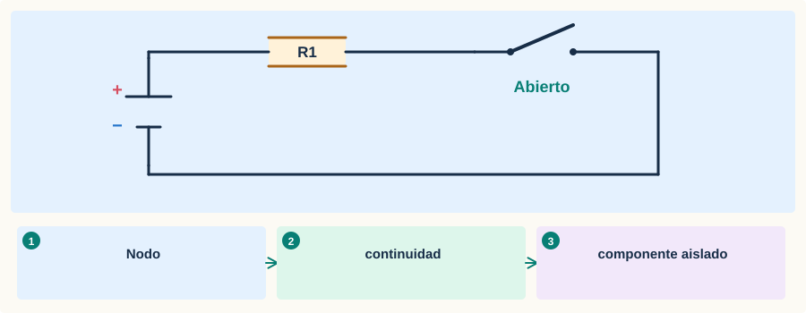

[← Anterior](02.md) · [Índice](../README.md) · [Siguiente →](04.md)

# 03 · Pruebas de continuidad y resistencia

*Diagrama didáctico y secuencia conceptual; no a escala.*

## ¿Qué es y por qué ocurre?

Con alimentación desconectada, verifica cables y nodos esperados. Aísla componentes si hay caminos alternos. El multímetro en continuidad tiene umbral, por eso un pitido no prueba resistencia exactamente cero. Compara valor con tolerancia e incertidumbre.

## Ejemplo explicado

> 330 Ω ±5% medidos 340 Ω aislado es compatible si incertidumbre razonable.

## Ahora tú

¿Por qué medir resistencia dentro de una red puede engañar?

[← Anterior](02.md) · [Índice](../README.md) · [Siguiente →](04.md)
