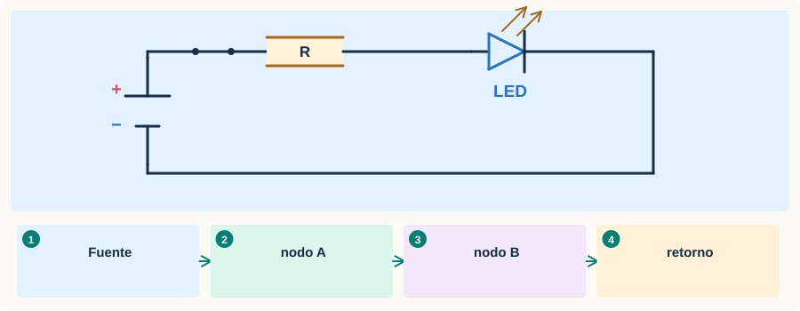

[← Anterior](03.md) · [Índice](../README.md) · [Siguiente →](05.md)

# 04 · Medición de tensión por etapas

*Diagrama didáctico y secuencia conceptual; no a escala.*

## ¿Qué es y por qué ocurre?

Tras verificar seguridad, energiza bajo supervisión. Mide fuente entre bornes y después cada nodo respecto a referencia. En circuito serie, una abertura puede dejar casi toda tensión sobre ella y cero sobre otros elementos, según caminos y medidor. No usar medidas de Ω con fuente conectada.

## Ejemplo explicado

> Fuente 3 V, interruptor abierto y carga conectada a retorno: tensión sobre contacto abierto≈3 V en modelo ideal.

## Ahora tú

Si Vfuente=0, ¿qué hipótesis revisas antes de sustituir LED?

[← Anterior](03.md) · [Índice](../README.md) · [Siguiente →](05.md)
