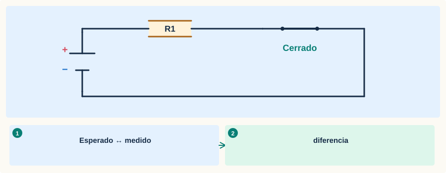

[← Anterior](04.md) · [Índice](../README.md) · [Siguiente →](06.md)

# 05 · Predicción frente a medición

*Diagrama didáctico y secuencia conceptual; no a escala.*

## ¿Qué es y por qué ocurre?

Calcula valor esperado con tolerancias. Para resistor, I inferida=VR/R evita abrir el circuito si se conoce R. El error relativo respecto a referencia no nula es |medido−esperado|/|esperado|×100%; no implica por sí solo falla si incertidumbre/modelo explican diferencia.

## Ejemplo explicado

> Esperado 3,00 V y medido 2,94 V: desviación relativa 2%.

## Ahora tú

Esperado 10 mA, medido 9,5 mA. ¿Desviación?

[← Anterior](04.md) · [Índice](../README.md) · [Siguiente →](06.md)
