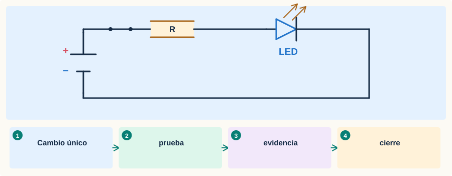

[← Anterior](05.md) · [Índice](../README.md) · [Actividades y cierre →](../descargas.md)

# 06 · Documentar y confirmar

*Diagrama didáctico y secuencia conceptual; no a escala.*

## ¿Qué es y por qué ocurre?

Cambia una cosa por vez; registra resultado y repite prueba. Una reparación exitosa exige verificar comportamiento esperado y que no introdujo otra falla. El informe incluye esquema, fotos/dibujos, valores, hipótesis descartadas, causa confirmada y prevención. En software el mismo patrón se usa para depurar.

## Ejemplo explicado

> Si invertir LED correctamente restaura funcionamiento, documenta polaridad inicial y verifica corriente limitada.

## Ahora tú

¿Por qué no cambiar tres componentes simultáneamente?

[← Anterior](05.md) · [Índice](../README.md) · [Actividades y cierre →](../descargas.md)
