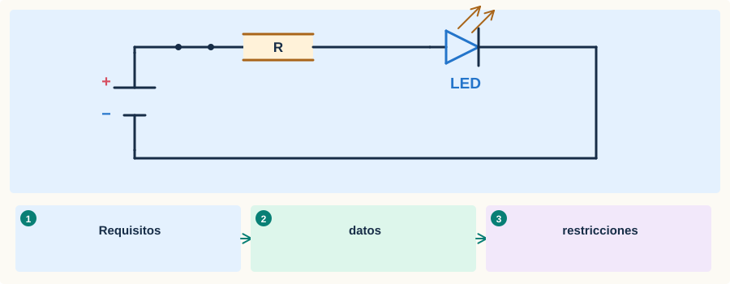
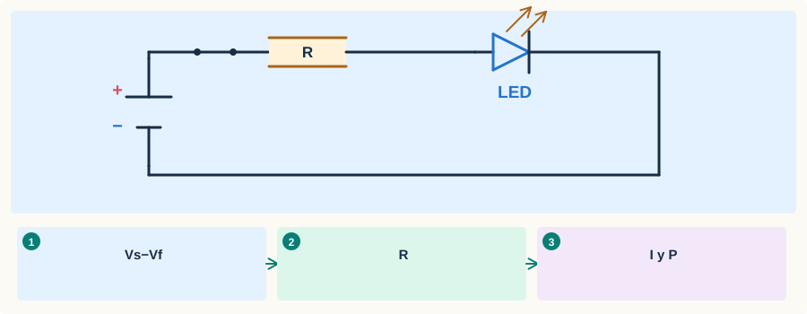
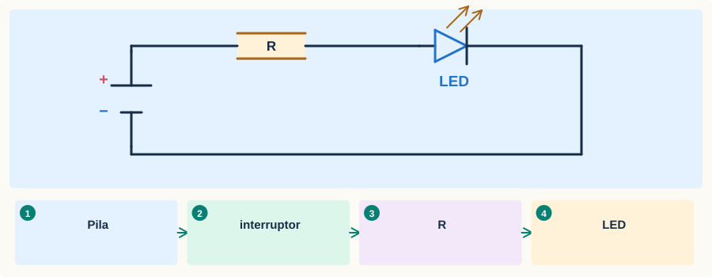
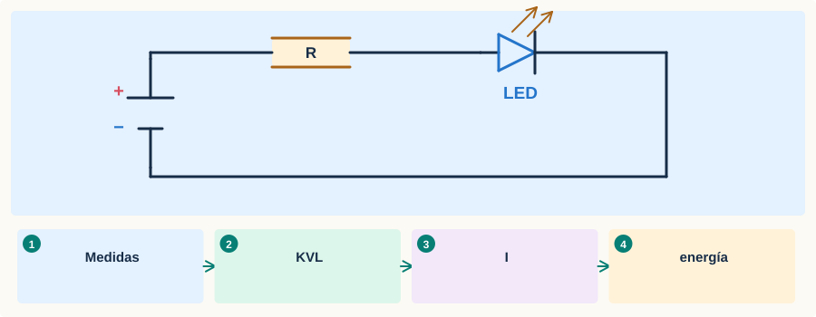
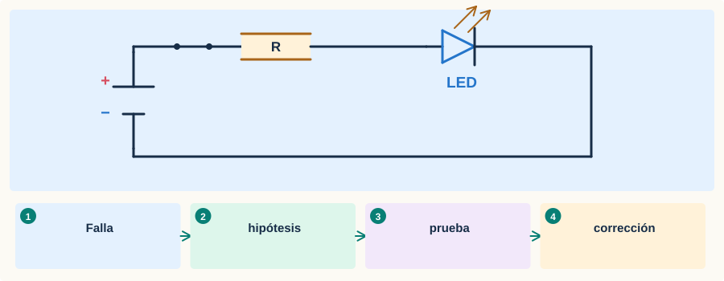
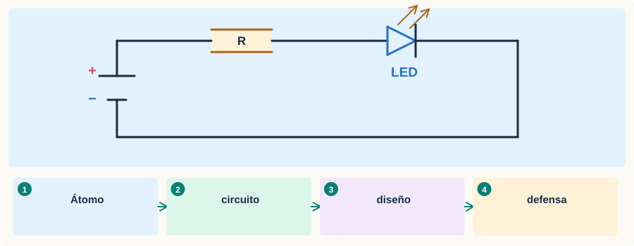

# Cuaderno de ejercicios · Clase 024

[PDF](024-ejercicios.pdf) · [← Índice](../README.md)

## 1. Requisitos y seguridad

**Ejemplo de estudio:** Requisito ejemplo: I objetivo≤5 mA, LED Vf aproximada 1,8–2,2 V según datos.

**Resuelve:** ¿Qué dato del LED necesitas además de color?

Escribe datos, procedimiento, unidades (si corresponde), dibujo y justificación. No consultes la solución antes.

## 2. Cálculo y selección

**Ejemplo de estudio:** Con 330 Ω ±5%, Rmin=313,5 Ω. Si Vs=3,2 V y Vfmin=1,8 V, I aproximada≤4,47 mA.

**Resuelve:** Con Vs=3 V y Vf=1,8 V, R=330 Ω. ¿I?

Escribe datos, procedimiento, unidades (si corresponde), dibujo y justificación. No consultes la solución antes.

## 3. Esquema y montaje

**Ejemplo de estudio:** El orden de resistor e interruptor en una serie ideal no altera I, pero sí potenciales de nodos intermedios.

**Resuelve:** ¿El resistor puede eliminarse si el LED no enciende?

Escribe datos, procedimiento, unidades (si corresponde), dibujo y justificación. No consultes la solución antes.

## 4. Pruebas y balance

**Ejemplo de estudio:** Si Vs=3,0 V, VR=1,05 V, VLED=1,95 V y R=330 Ω, I≈3,18 mA; residual 0 V.

**Resuelve:** Con VR=1,2 V y R=330 Ω, calcula I.

Escribe datos, procedimiento, unidades (si corresponde), dibujo y justificación. No consultes la solución antes.

## 5. Diagnóstico y mejora

**Ejemplo de estudio:** Una resistencia mayor reduce I a V fija si la aproximación Vf se mantiene.

**Resuelve:** ¿Qué evidencia demuestra que corregiste una abertura?

Escribe datos, procedimiento, unidades (si corresponde), dibujo y justificación. No consultes la solución antes.

## 6. Sustentación: integrar fundamentos

**Ejemplo de estudio:** Un proyecto que funciona pero no puede explicarse no demuestra dominio suficiente.

**Resuelve:** ¿En qué se diferencian KCL y KVL en tu circuito?

Escribe datos, procedimiento, unidades (si corresponde), dibujo y justificación. No consultes la solución antes.
