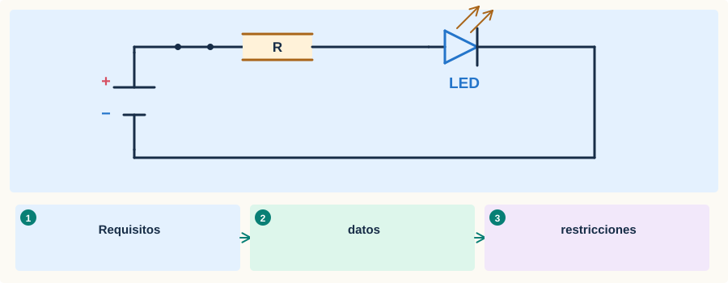
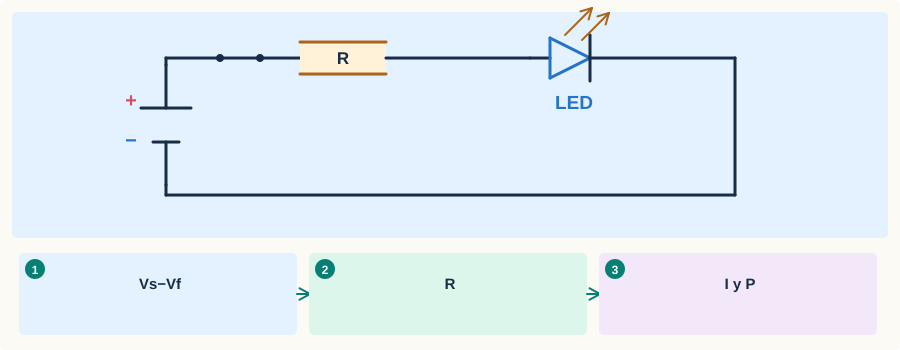
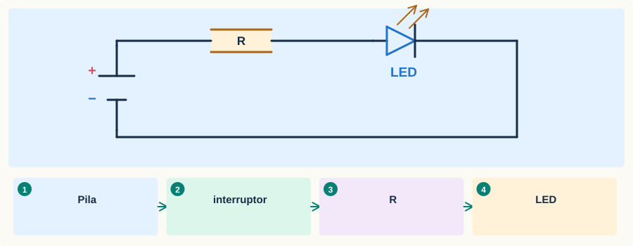
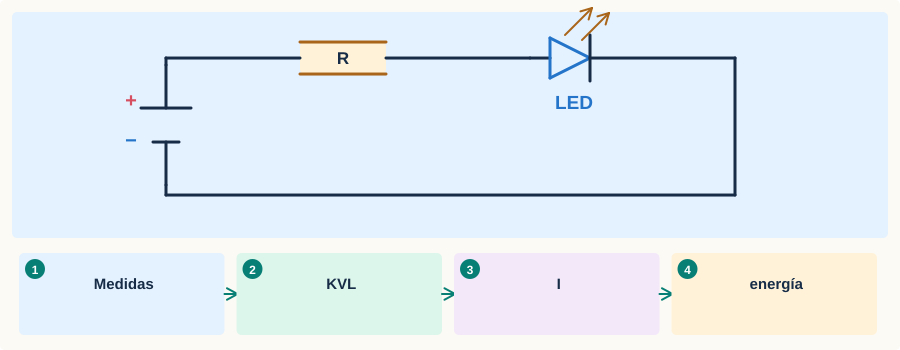
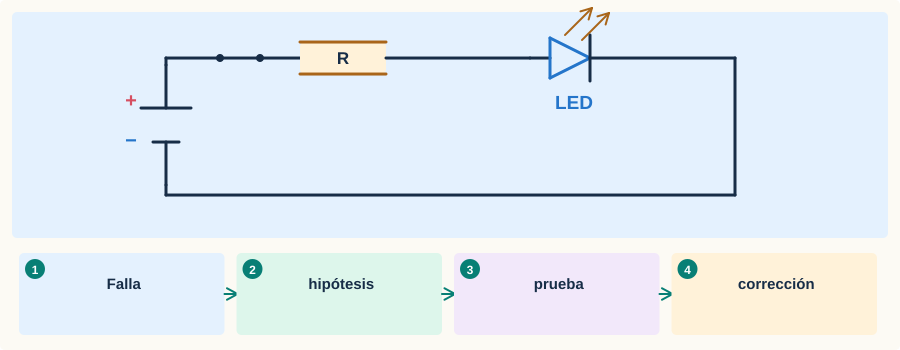
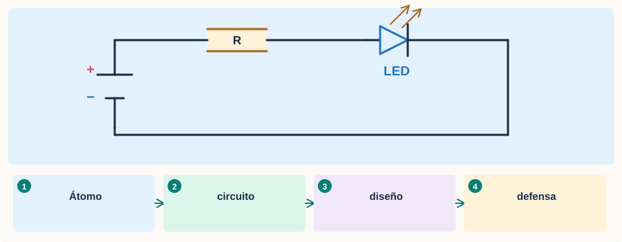

# Proyecto final, evaluación y sustentación

[← Índice](../README.md)

## 01 · Requisitos y seguridad

Diseñar iluminación de baja tensión con interruptor, un LED rojo de datos conocidos y resistor limitador. Fuente limitada de 3 V o portapilas adecuado bajo supervisión. Debe encender y apagar de forma reproducible, no sobrepasar límites de corriente, tensión ni potencia y permitir diagnóstico seguro.

**Ejemplo:** Requisito ejemplo: I objetivo≤5 mA, LED Vf aproximada 1,8–2,2 V según datos.

**Aplica:** ¿Qué dato del LED necesitas además de color?

---

## 02 · Cálculo y selección

Para 3 V y Vf≈1,8 V mínimo supuesto a corriente relevante, R≥(3−1,8)/0,005=240 Ω. Usar 330 Ω nominal, comprobar tolerancia y tensión máxima real. Con 3 V ideal y Vf≈2 V: I≈3,03 mA; P_R≈3,03 mW. La caída real varía; si no se cumplen requisitos, recalcular con datos.

**Ejemplo:** Con 330 Ω ±5%, Rmin=313,5 Ω. Si Vs=3,2 V y Vfmin=1,8 V, I aproximada≤4,47 mA.

**Aplica:** Con Vs=3 V y Vf=1,8 V, R=330 Ω. ¿I?

---

## 03 · Esquema y montaje

Dibuja fuente, interruptor, resistor y LED en serie, con polaridades y referencia. Identifica nodos de protoboard; desenergiza al cablear. Comprueba continuidad prevista y ausencia de puentes, y solicita revisión antes de energizar. No conectes amperímetro directamente a fuente.

**Ejemplo:** El orden de resistor e interruptor en una serie ideal no altera I, pero sí potenciales de nodos intermedios.

**Aplica:** ¿El resistor puede eliminarse si el LED no enciende?

---

## 04 · Pruebas y balance

Con fuente revisada, mide Vs, VR y VLED con voltímetro DC en paralelo; calcula I≈VR/R medido aislado previamente. Comprueba Vs≈VR+VLED y Pfuente≈PR+PLED en modelo ideal. Registra incertidumbre, comportamiento abierto/cerrado y repetición. No persigas cero residual exacto.

**Ejemplo:** Si Vs=3,0 V, VR=1,05 V, VLED=1,95 V y R=330 Ω, I≈3,18 mA; residual 0 V.

**Aplica:** Con VR=1,2 V y R=330 Ω, calcula I.

---

## 05 · Diagnóstico y mejora

El docente propone una abertura o conexión invertida segura previamente revisada. Estudiante localiza con hipótesis y mediciones, desconecta para corregir y repite pruebas. Propón mejora justificada, por ejemplo indicador de estado o cambio de R dentro de límites; no añadir cargas sin recalcular.

**Ejemplo:** Una resistencia mayor reduce I a V fija si la aproximación Vf se mantiene.

**Aplica:** ¿Qué evidencia demuestra que corregiste una abertura?

---

## 06 · Sustentación: integrar fundamentos

Explica de dónde viene energía, cómo campo provoca deriva, por qué resistor transfiere energía, qué significa voltaje, cómo se conserva carga y energía, por qué LED es no óhmico y cómo medir seguro. Entrega memoria técnica, esquema, cálculos, tabla, dibujos y conclusiones. La nota mínima propuesta es 80/100 y seguridad obligatoria.

**Ejemplo:** Un proyecto que funciona pero no puede explicarse no demuestra dominio suficiente.

**Aplica:** ¿En qué se diferencian KCL y KVL en tu circuito?

---
