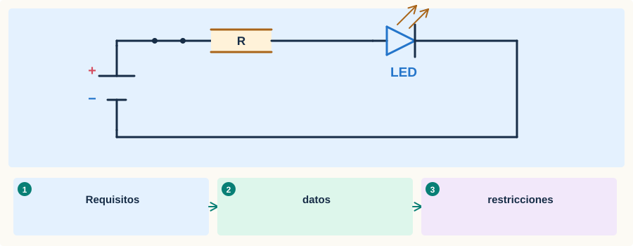

[← Portada](../README.md) · [Índice](../README.md) · [Siguiente →](02.md)

# 01 · Requisitos y seguridad

*Diagrama didáctico y secuencia conceptual; no a escala.*

## ¿Qué es y por qué ocurre?

Diseñar iluminación de baja tensión con interruptor, un LED rojo de datos conocidos y resistor limitador. Fuente limitada de 3 V o portapilas adecuado bajo supervisión. Debe encender y apagar de forma reproducible, no sobrepasar límites de corriente, tensión ni potencia y permitir diagnóstico seguro.

## Ejemplo explicado

> Requisito ejemplo: I objetivo≤5 mA, LED Vf aproximada 1,8–2,2 V según datos.

## Ahora tú

¿Qué dato del LED necesitas además de color?

[← Portada](../README.md) · [Índice](../README.md) · [Siguiente →](02.md)
