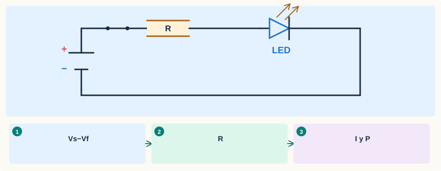
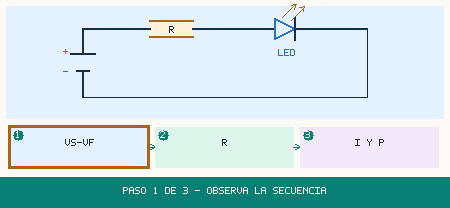

[← Anterior](01.md) · [Índice](../README.md) · [Siguiente →](03.md)

# 02 · Cálculo y selección

*Diagrama didáctico y secuencia conceptual; no a escala.*

## ¿Qué es y por qué ocurre?

Para 3 V y Vf≈1,8 V mínimo supuesto a corriente relevante, R≥(3−1,8)/0,005=240 Ω. Usar 330 Ω nominal, comprobar tolerancia y tensión máxima real. Con 3 V ideal y Vf≈2 V: I≈3,03 mA; P_R≈3,03 mW. La caída real varía; si no se cumplen requisitos, recalcular con datos.

## Ejemplo explicado

> Con 330 Ω ±5%, Rmin=313,5 Ω. Si Vs=3,2 V y Vfmin=1,8 V, I aproximada≤4,47 mA.

## Ahora tú

Con Vs=3 V y Vf=1,8 V, R=330 Ω. ¿I?

## Secuencia animada

*Se resaltan etapas del diagrama, no se pretende simular el movimiento físico real.*

[← Anterior](01.md) · [Índice](../README.md) · [Siguiente →](03.md)
