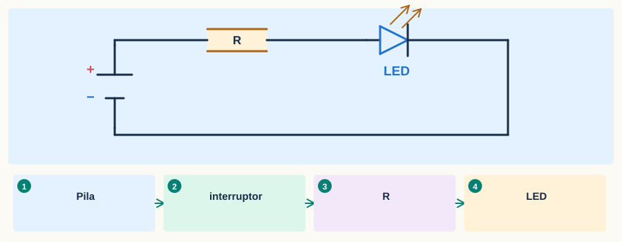

[← Anterior](02.md) · [Índice](../README.md) · [Siguiente →](04.md)

# 03 · Esquema y montaje

*Diagrama didáctico y secuencia conceptual; no a escala.*

## ¿Qué es y por qué ocurre?

Dibuja fuente, interruptor, resistor y LED en serie, con polaridades y referencia. Identifica nodos de protoboard; desenergiza al cablear. Comprueba continuidad prevista y ausencia de puentes, y solicita revisión antes de energizar. No conectes amperímetro directamente a fuente.

## Ejemplo explicado

> El orden de resistor e interruptor en una serie ideal no altera I, pero sí potenciales de nodos intermedios.

## Ahora tú

¿El resistor puede eliminarse si el LED no enciende?

[← Anterior](02.md) · [Índice](../README.md) · [Siguiente →](04.md)
