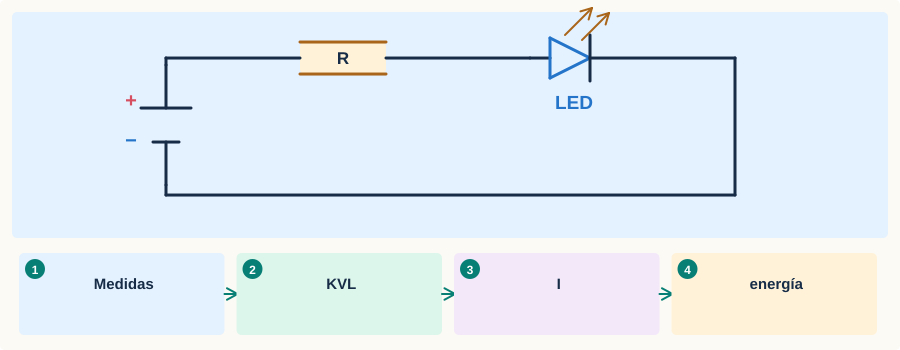

[← Anterior](03.md) · [Índice](../README.md) · [Siguiente →](05.md)

# 04 · Pruebas y balance

*Diagrama didáctico y secuencia conceptual; no a escala.*

## ¿Qué es y por qué ocurre?

Con fuente revisada, mide Vs, VR y VLED con voltímetro DC en paralelo; calcula I≈VR/R medido aislado previamente. Comprueba Vs≈VR+VLED y Pfuente≈PR+PLED en modelo ideal. Registra incertidumbre, comportamiento abierto/cerrado y repetición. No persigas cero residual exacto.

## Ejemplo explicado

> Si Vs=3,0 V, VR=1,05 V, VLED=1,95 V y R=330 Ω, I≈3,18 mA; residual 0 V.

## Ahora tú

Con VR=1,2 V y R=330 Ω, calcula I.

[← Anterior](03.md) · [Índice](../README.md) · [Siguiente →](05.md)
