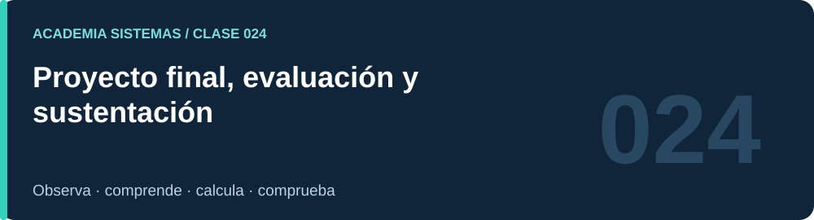
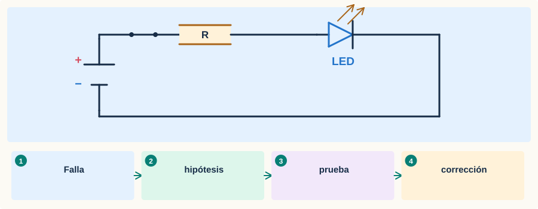

[← Anterior](04.md) · [Índice](../README.md) · [Siguiente →](06.md)

# 05 · Diagnóstico y mejora

*Diagrama didáctico y secuencia conceptual; no a escala.*

## ¿Qué es y por qué ocurre?

El docente propone una abertura o conexión invertida segura previamente revisada. Estudiante localiza con hipótesis y mediciones, desconecta para corregir y repite pruebas. Propón mejora justificada, por ejemplo indicador de estado o cambio de R dentro de límites; no añadir cargas sin recalcular.

## Ejemplo explicado

> Una resistencia mayor reduce I a V fija si la aproximación Vf se mantiene.

## Ahora tú

¿Qué evidencia demuestra que corregiste una abertura?

[← Anterior](04.md) · [Índice](../README.md) · [Siguiente →](06.md)
