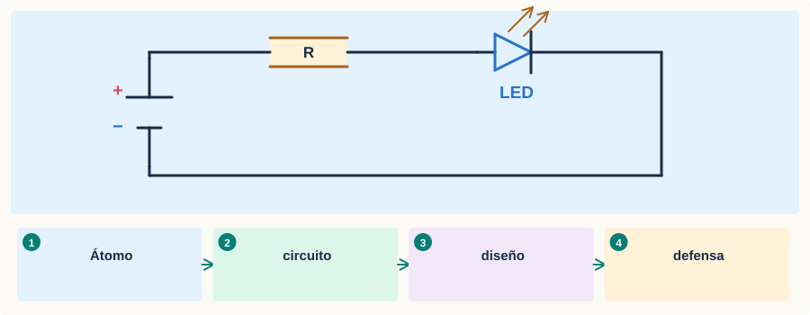

[← Anterior](05.md) · [Índice](../README.md) · [Actividades y cierre →](../descargas.md)

# 06 · Sustentación: integrar fundamentos

*Diagrama didáctico y secuencia conceptual; no a escala.*

## ¿Qué es y por qué ocurre?

Explica de dónde viene energía, cómo campo provoca deriva, por qué resistor transfiere energía, qué significa voltaje, cómo se conserva carga y energía, por qué LED es no óhmico y cómo medir seguro. Entrega memoria técnica, esquema, cálculos, tabla, dibujos y conclusiones. La nota mínima propuesta es 80/100 y seguridad obligatoria.

## Ejemplo explicado

> Un proyecto que funciona pero no puede explicarse no demuestra dominio suficiente.

## Ahora tú

¿En qué se diferencian KCL y KVL en tu circuito?

[← Anterior](05.md) · [Índice](../README.md) · [Actividades y cierre →](../descargas.md)
