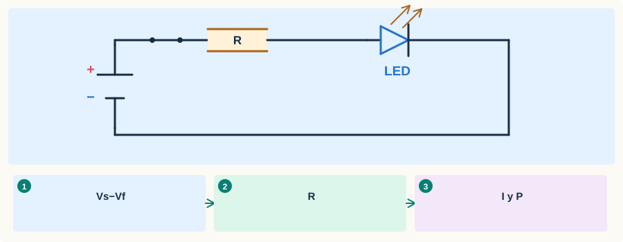

# Práctica guiada · Proyecto final, evaluación y sustentación

**Objetivo:** ¿Puedes diseñar y defender un circuito sin copiarlo?

## Procedimiento

Entrega proyecto físico supervisado o simulación documentada si no hay equipos; la habilidad física de medición se valida aparte. Rúbrica: fundamentos 25, diseño/cálculos 25, montaje y pruebas 25, diagnóstico 10, informe y defensa 15. Seguridad es requisito no compensable. Evalúa también conceptos acumulados desde clase 001.

1. Formula hipótesis y dibuja el modelo antes de intervenir.
2. Identifica magnitudes que cambian y las que permanecen fijas.
3. Realiza solo el procedimiento seguro descrito; registra resultados y unidades.
4. Compara con predicción; explica diferencias, incertidumbre y limitaciones.

| Ensayo | Condiciones | Predicción | Observación o cálculo | Explicación |
|---|---|---|---|---|
| 1 | | | | |
| 2 | | | | |
| 3 | | | | |

Rúbrica: predicción 25, registro 25, explicación 40, presentación 10. Seguridad obligatoria. En simulación, los resultados calculados no son evidencia experimental independiente.

[Simulador complementario PhET](https://phet.colorado.edu/es/simulations/circuit-construction-kit-dc) · [Plantilla de informe](../../../../../plantillas/informe-laboratorio.pdf) · [PDF](024-laboratorio.pdf) · [← Índice](../README.md)
