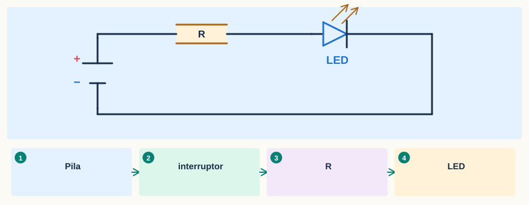

# Proyecto final · Sistema de iluminación de bajo voltaje

[Clase 024 completa](../clases/024-proyecto-evaluacion/README.md) · [Guía PDF](../clases/024-proyecto-evaluacion/lecturas/024-guia.pdf) · [Práctica PDF](../clases/024-proyecto-evaluacion/practicas/024-laboratorio.pdf)

Fuente limitada de **3 V**, interruptor, LED rojo de datos conocidos y resistor de 330 Ω (0,25 W), protoboard y multímetro adecuado. Verificar tensión máxima real, Vf mínimo a la corriente prevista, tolerancia y hoja de datos; recalcular si cambian condiciones. Con Vf≈2 V, I≈3,03 mA; con Vs máx. 3,2 V, Vf mínimo supuesto 1,8 V y R mínima 313,5 Ω, I≈4,47 mA. Los valores son modelos, no garantía universal.

**Seguridad obligatoria:** desenergizar antes de cablear, fuente limitada, revisión del docente, no red doméstica, no cortos, no amperímetro directo a fuente. Si no hay equipos adecuados, simular; validar medición física por separado.

Entregables: requisitos, esquema, cálculos, montaje, mediciones con unidades e incertidumbre, diagnóstico, pruebas repetibles, conclusiones y sustentación.

| Criterio | Puntos |
|---|---:|
| Comprensión de fundamentos | 25 |
| Diseño y cálculos | 25 |
| Montaje y pruebas | 25 |
| Diagnóstico | 10 |
| Informe y defensa | 15 |

Meta 80/100 y seguridad no compensable. [Rúbrica imprimible](../../../plantillas/rubrica-proyecto.pdf) · [Evaluación acumulativa](../pruebas/README.md) · [Volver al capítulo](../README.md)
