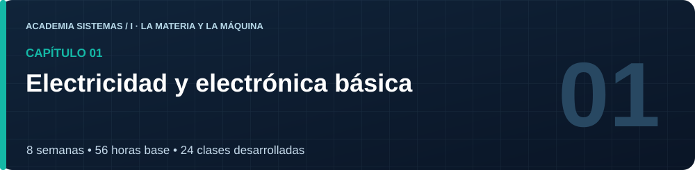

[Inicio](../../../README.md) · [Capítulo 01](../README.md)

# Pruebas

- [Evaluación 001](../clases/001-materia-atomos-electrones/evaluacion.md)
- Evaluación de módulo: pendiente.
- Las soluciones están separadas en la carpeta de la clase; son públicas.

## Evaluación avanzada

[Prueba de 100 puntos](../clases/001-materia-atomos-electrones/pruebas/01-evaluacion-avanzada.pdf) · [Rúbrica docente](../clases/001-materia-atomos-electrones/soluciones/01-solucionario-ampliado.pdf).

---

ACADEMIA SISTEMAS · [Índice general](../../../README.md)
