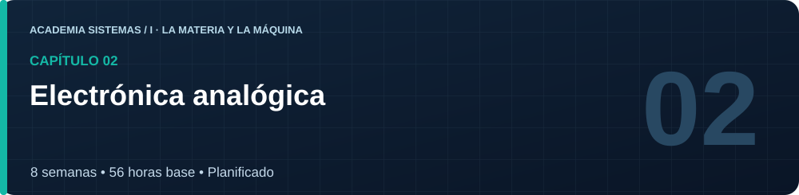

[Inicio](../../README.md) · [Pensum](../../PENSUM.md)

# Capítulo 02 · Electrónica analógica

> Este capítulo forma parte de la ruta progresiva; sus materiales completos están planificados.

**4 semanas · 28 horas base · Planificado**

## Qué vas a aprender

- Condensadores
- inductores
- diodos
- transistores BJT y MOSFET
- filtros y amplificación

## Biblioteca del capítulo

| Sección | Contenido |
|---|---|
| [📖 Clases](clases/README.md) | Lecturas, presentaciones y actividades |
| [🧪 Laboratorios](laboratorios/README.md) | Experimentos y guías de práctica |
| [📝 Pruebas](pruebas/README.md) | Evaluaciones y criterios |
| [🛠️ Proyecto](proyecto/README.md) | Aplicación integradora |

## Proyecto de cierre

**Sensor con etapa de acondicionamiento**

La guía detallada está pendiente de desarrollo.

---

[← Capítulo 01](../01-electronica-basica/README.md) · [Índice general](../../README.md) · [Capítulo 03 →](../03-electronica-digital/README.md)
