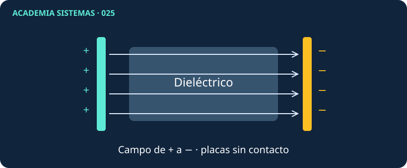

[← Clase 024](../../../01-electronica-basica/clases/024-proyecto-evaluacion/README.md) · [Índice](../README.md) · [Clase 026 →](../026-inductores-rl/README.md)

# Clase 025 · Condensadores: dieléctrico, ESR, carga RC y energía

**Edición web inicial · 120–150 min orientativos.**

> ¿Por qué un condensador no cambia de tensión instantáneamente con corriente finita?

[▶ Comenzar](libro/01.md) · [Libro HTML imprimible](libro.html) · [Materiales](descargas.md)

- [1 · Las dos placas y el dieléctrico](libro/01.md)
- [2 · De dónde sale la constante de tiempo](libro/02.md)
- [3 · Energía, ESR y pérdidas](libro/03.md)
- [4 · Ejemplo resuelto](libro/04.md)

## Materiales

[Lectura](lecturas/guia-ampliada.md) · [Ejercicios](ejercicios/README.md) · [Laboratorio](practicas/README.md) · [Evaluación](pruebas/README.md) · [Soluciones](soluciones/README.md) · [Guía docente](guia-docente.md)

> Todas las prácticas de esta edición son virtuales. Nunca conectar la red doméstica, abrir fuentes ni provocar cortos. Montajes físicos posteriores solo con supervisión y fuente aislada de baja tensión limitada.

[← Clase 024](../../../01-electronica-basica/clases/024-proyecto-evaluacion/README.md) · [Índice](../README.md) · [Clase 026 →](../026-inductores-rl/README.md)
