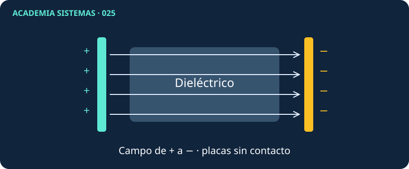
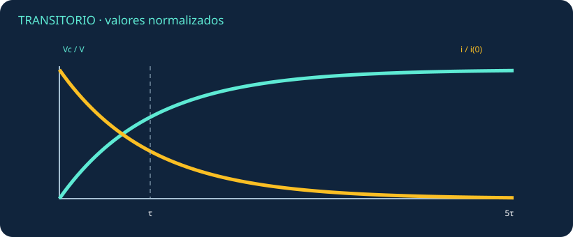

[← Clase](../README.md)

# Condensadores: dieléctrico, ESR, carga RC y energía

> ¿Por qué un condensador no cambia de tensión instantáneamente con corriente finita?

## Las dos placas y el dieléctrico

Un condensador tiene dos conductores separados por un aislante. Al conectar una fuente, esta retira electrones de una placa y los incorpora a la otra por el circuito exterior. El aislante ideal impide el paso directo de electrones, pero el campo eléctrico actúa sobre sus moléculas y las polariza. Esa polarización permite almacenar más carga a igual diferencia de potencial. Para placas paralelas grandes y cercanas, C≈εA/d: mayor área A o permitividad ε aumentan C, mayor distancia d la reduce. Q=CV, de modo que 1 F=1 C/V. No se crea carga: se separa.

**Comprueba:** Dibuja las cargas de cada placa y el campo eléctrico entre ellas.

## De dónde sale la constante de tiempo

En el circuito serie con una fuente V, R y C, Kirchhoff da V=Ri+Vc. Como i=dQ/dt=C·dVc/dt, resulta dVc/dt=(V−Vc)/(RC). Desde Vc=0, la solución es Vc=V(1−e^(−t/RC)); en descarga a través de R, Vc=V0·e^(−t/RC). La constante τ=RC tiene unidades Ω·F=s. En el instante inicial i=V/R, y conforme Vc aumenta la caída en R disminuye: la corriente baja. A una τ, Vc alcanza 63,2 % de su valor final; a cinco τ, 99,3 %. Si i es finita, el cambio de Vc en un intervalo infinitesimal también lo es.

**Comprueba:** Predice corriente y tensión en 0, τ y 5τ antes de calcular.

## Energía, ESR y pérdidas

Mover una carga incremental dQ contra la tensión V requiere trabajo dE=VdQ. Como V=Q/C, integrar desde 0 hasta Q da E=Q²/(2C)=½CV². Esa energía reside en el campo eléctrico. Un condensador real tiene resistencia serie equivalente (ESR), fuga y tensión límite. En corriente pulsante, ESR disipa I_rms²·ESR. Un electrolítico polarizado puede dañarse si se invierte; nunca se descarga mediante un corto, sino mediante resistencia apropiada y comprobando tensión.

**Comprueba:** Separa en tu modelo la capacitancia ideal y la resistencia que disipa energía.

## Ejemplo resuelto

Con V=5 V, R=10 kΩ y C=100 µF=0,0001 F: τ=10 000×0,0001=1 s. Vc(1 s)=5(1−e⁻¹)=3,16 V; I inicial=5/10 000=0,5 mA; energía final=½·0,0001·25=0,00125 J. La energía suministrada por la fuente durante una carga ideal desde cero es CV²; la mitad se almacena y la otra mitad se disipa en R.

**Comprueba:** ¿Qué cambia al duplicar R?
