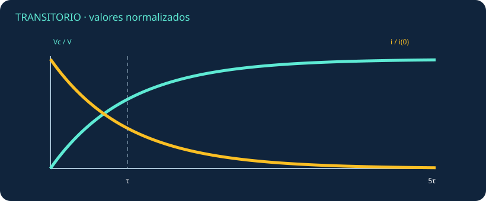

[← Anterior](01.md) · [Índice](../README.md) · [Siguiente →](03.md)

# 025 · Página 2/4 · De dónde sale la constante de tiempo

En el circuito serie con una fuente V, R y C, Kirchhoff da V=Ri+Vc. Como i=dQ/dt=C·dVc/dt, resulta dVc/dt=(V−Vc)/(RC). Desde Vc=0, la solución es Vc=V(1−e^(−t/RC)); en descarga a través de R, Vc=V0·e^(−t/RC). La constante τ=RC tiene unidades Ω·F=s. En el instante inicial i=V/R, y conforme Vc aumenta la caída en R disminuye: la corriente baja. A una τ, Vc alcanza 63,2 % de su valor final; a cinco τ, 99,3 %. Si i es finita, el cambio de Vc en un intervalo infinitesimal también lo es.

> **Comprueba tu comprensión:** Predice corriente y tensión en 0, τ y 5τ antes de calcular.

[← Anterior](01.md) · [Índice](../README.md) · [Siguiente →](03.md)
