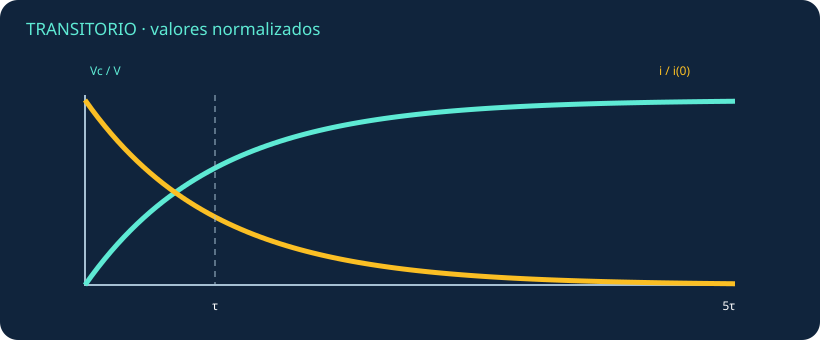

[← Anterior](02.md) · [Índice](../README.md) · [Siguiente →](04.md)

# 025 · Página 3/4 · Energía, ESR y pérdidas

Mover una carga incremental dQ contra la tensión V requiere trabajo dE=VdQ. Como V=Q/C, integrar desde 0 hasta Q da E=Q²/(2C)=½CV². Esa energía reside en el campo eléctrico. Un condensador real tiene resistencia serie equivalente (ESR), fuga y tensión límite. En corriente pulsante, ESR disipa I_rms²·ESR. Un electrolítico polarizado puede dañarse si se invierte; nunca se descarga mediante un corto, sino mediante resistencia apropiada y comprobando tensión.

> **Comprueba tu comprensión:** Separa en tu modelo la capacitancia ideal y la resistencia que disipa energía.

[← Anterior](02.md) · [Índice](../README.md) · [Siguiente →](04.md)
