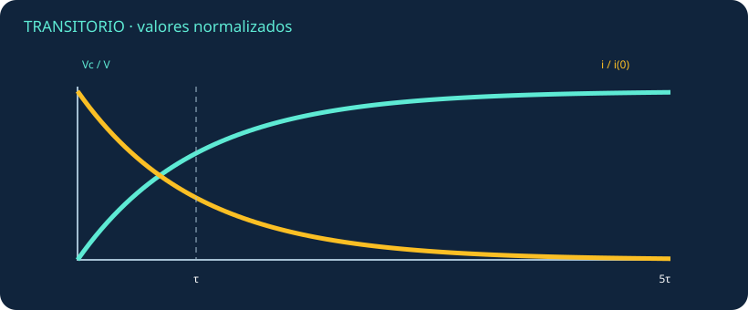

[← Anterior](03.md) · [Índice](../README.md) · [Ejercicios](../ejercicios/README.md) · [Siguiente clase →](../../026-inductores-rl/libro/01.md)

# 025 · Página 4/4 · Ejemplo resuelto

Con V=5 V, R=10 kΩ y C=100 µF=0,0001 F: τ=10 000×0,0001=1 s. Vc(1 s)=5(1−e⁻¹)=3,16 V; I inicial=5/10 000=0,5 mA; energía final=½·0,0001·25=0,00125 J. La energía suministrada por la fuente durante una carga ideal desde cero es CV²; la mitad se almacena y la otra mitad se disipa en R.

> **Comprueba tu comprensión:** ¿Qué cambia al duplicar R?

[← Anterior](03.md) · [Índice](../README.md) · [Ejercicios](../ejercicios/README.md) · [Siguiente clase →](../../026-inductores-rl/libro/01.md)
