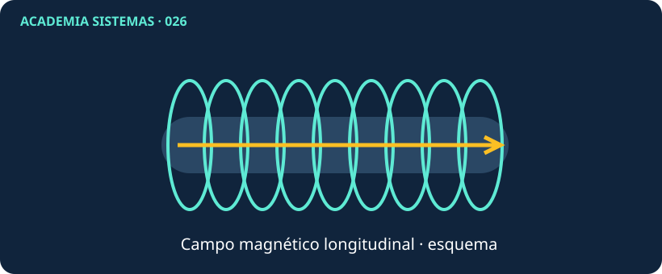

[← Clase 025](../025-condensadores-rc/README.md) · [Índice](../README.md) · [Clase 027 →](../027-rlc-resonancia/README.md)

# Clase 026 · Inductores: campo, energía magnética y transitorios RL

**Edición web inicial · 120–150 min orientativos.**

> ¿Por qué una bobina se opone a cambios de corriente, no a toda corriente?

[▶ Comenzar](libro/01.md) · [Libro HTML imprimible](libro.html) · [Materiales](descargas.md)

- [1 · De la corriente al campo magnético](libro/01.md)
- [2 · Transitorio RL paso a paso](libro/02.md)
- [3 · Energía, saturación y protección](libro/03.md)
- [4 · Ejemplo resuelto](libro/04.md)

## Materiales

[Lectura](lecturas/guia-ampliada.md) · [Ejercicios](ejercicios/README.md) · [Laboratorio](practicas/README.md) · [Evaluación](pruebas/README.md) · [Soluciones](soluciones/README.md) · [Guía docente](guia-docente.md)

> Todas las prácticas de esta edición son virtuales. Nunca conectar la red doméstica, abrir fuentes ni provocar cortos. Montajes físicos posteriores solo con supervisión y fuente aislada de baja tensión limitada.

[← Clase 025](../025-condensadores-rc/README.md) · [Índice](../README.md) · [Clase 027 →](../027-rlc-resonancia/README.md)
