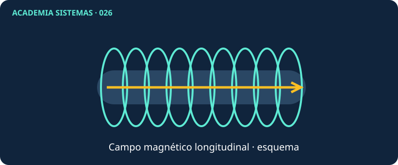

[← Clase](../README.md) · [Índice](../README.md) · [Siguiente →](02.md)

# 026 · Página 1/4 · De la corriente al campo magnético

La corriente produce campo magnético alrededor del conductor. Las espiras de una bobina hacen que gran parte de sus campos contribuyan al flujo enlazado. Un núcleo de permeabilidad elevada puede aumentar el flujo para una corriente dada. En régimen lineal el flujo enlazado λ=Li. La inductancia L se mide en henrios: 1 H=1 V·s/A. Faraday y Lenz explican por qué un cambio de flujo induce una tensión cuyo efecto se opone a la variación. Con convenio pasivo vL=L·di/dt. Una corriente constante no genera tensión inductiva ideal.

> **Comprueba tu comprensión:** Dibuja espiras y el campo dentro de la bobina. Señala qué sucede cuando aumenta i.

[← Clase](../README.md) · [Índice](../README.md) · [Siguiente →](02.md)
