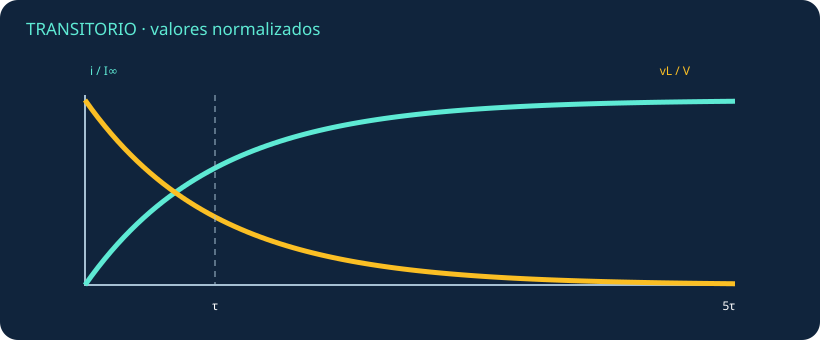

[← Anterior](01.md) · [Índice](../README.md) · [Siguiente →](03.md)

# 026 · Página 2/4 · Transitorio RL paso a paso

Kirchhoff en una rama serie da V=Ri+L·di/dt. Si inicialmente i=0, la solución es i(t)=V/R·(1−e^(−tR/L)). τ=L/R en segundos. En el instante inicial la corriente no ha aumentado y casi todo V aparece en L; al final i≈V/R y vL≈0. Durante una descarga con trayectoria cerrada, i=I0e^(−tR/L). Una tensión finita no produce un salto instantáneo de corriente, de forma análoga a la continuidad del voltaje en C.

> **Comprueba tu comprensión:** Compara i(t) en RL con Vc(t) en RC. Identifica qué magnitud no puede cambiar abruptamente.

[← Anterior](01.md) · [Índice](../README.md) · [Siguiente →](03.md)
