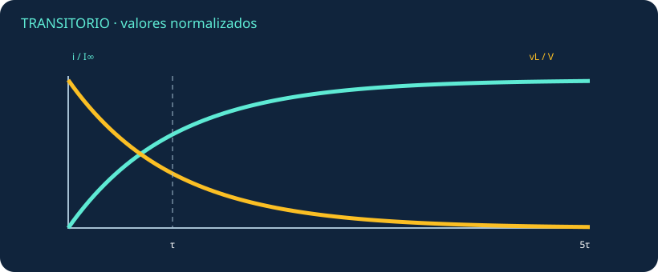

[← Anterior](02.md) · [Índice](../README.md) · [Siguiente →](04.md)

# 026 · Página 3/4 · Energía, saturación y protección

La energía magnética E=½LI² se deduce integrando potencia p=vi=L·i·di/dt. Una interrupción rápida de corriente puede generar tensión elevada: la energía debe salir hacia alguna trayectoria. En relés DC se utiliza una ruta de rueda libre correctamente orientada. El cobre real tiene resistencia y disipa calor. Un núcleo puede saturarse a corriente alta y reducir su inductancia efectiva, acelerando el crecimiento de corriente.

> **Comprueba tu comprensión:** Explica por qué no debe abrirse una bobina energizada sin una ruta de corriente prevista.

[← Anterior](02.md) · [Índice](../README.md) · [Siguiente →](04.md)
