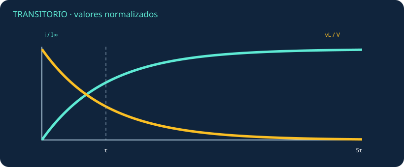

[← Anterior](03.md) · [Índice](../README.md) · [Ejercicios](../ejercicios/README.md) · [Siguiente clase →](../../027-rlc-resonancia/libro/01.md)

# 026 · Página 4/4 · Ejemplo resuelto

V=5 V, R=100 Ω, L=0,1 H: τ=0,1/100=0,001 s. I∞=5/100=0,05 A. I(τ)=0,05(1−e⁻¹)=31,6 mA; vL(τ)=5e⁻¹=1,84 V. E∞=½·0,1·0,05²=0,000125 J.

> **Comprueba tu comprensión:** ¿Qué pasa al duplicar L?

[← Anterior](03.md) · [Índice](../README.md) · [Ejercicios](../ejercicios/README.md) · [Siguiente clase →](../../027-rlc-resonancia/libro/01.md)
